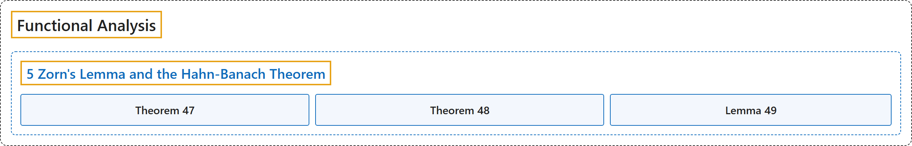

# 5 Zorn's Lemma and the Hahn-Banach Theorem

## Classification

## Glossary

| Term | Definition | 中文翻译 | Source |
|---|---|---|---|
| **5 Zorn's Lemma and the Hahn-Banach Theorem** 佐恩引理与哈恩-巴拿赫定理 | (No definition) | （无定义） | [Rodriguez, 2021, lecture 5](https://ocw.mit.edu/courses/18-102-introduction-to-functional-analysis-spring-2021/06f9cf855f9f5eaa1898f3e684e05cec_MIT18_102s21_lec5.pdf) |
| **Theorem 47** 定理 47 | (pending) | （待补） | [Rodriguez, 2021, lecture 5, Theorem 47](https://ocw.mit.edu/courses/18-102-introduction-to-functional-analysis-spring-2021/06f9cf855f9f5eaa1898f3e684e05cec_MIT18_102s21_lec5.pdf) |
| **Theorem 48** 定理 48 | (pending) | （待补） | [Rodriguez, 2021, lecture 5, Theorem 48](https://ocw.mit.edu/courses/18-102-introduction-to-functional-analysis-spring-2021/06f9cf855f9f5eaa1898f3e684e05cec_MIT18_102s21_lec5.pdf) |
| **Lemma 49** 引理 49 | (pending) | （待补） | [Rodriguez, 2021, lecture 5, Lemma 49](https://ocw.mit.edu/courses/18-102-introduction-to-functional-analysis-spring-2021/06f9cf855f9f5eaa1898f3e684e05cec_MIT18_102s21_lec5.pdf) |

## References

Rodriguez, C. (2021). *18.102 Introduction to functional analysis: Lecture notes* (Spring 2021). MIT OpenCourseWare. Retrieved October 31, 2026, from <https://ocw.mit.edu/courses/18-102-introduction-to-functional-analysis-spring-2021/>
