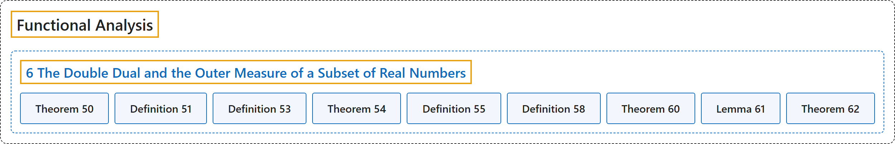

# 6 The Double Dual and the Outer Measure of a Subset of Real Numbers

## Classification

## Glossary

| Term | Definition | 中文翻译 | Source |
|---|---|---|---|
| **6 The Double Dual and the Outer Measure of a Subset of Real Numbers** 二次对偶与实数子集的外测度 | (No definition) | （无定义） | [Rodriguez, 2021, lecture 6](https://ocw.mit.edu/courses/18-102-introduction-to-functional-analysis-spring-2021/806234baa2feadee4b54cdf679382257_MIT18_102s21_lec6.pdf) |
| **Theorem 50** 定理 50 | (pending) | （待补） | [Rodriguez, 2021, lecture 6, Theorem 50](https://ocw.mit.edu/courses/18-102-introduction-to-functional-analysis-spring-2021/806234baa2feadee4b54cdf679382257_MIT18_102s21_lec6.pdf) |
| **Definition 51** 定义 51 | (pending) | （待补） | [Rodriguez, 2021, lecture 6, Definition 51](https://ocw.mit.edu/courses/18-102-introduction-to-functional-analysis-spring-2021/806234baa2feadee4b54cdf679382257_MIT18_102s21_lec6.pdf) |
| **Definition 53** 定义 53 | (pending) | （待补） | [Rodriguez, 2021, lecture 6, Definition 53](https://ocw.mit.edu/courses/18-102-introduction-to-functional-analysis-spring-2021/806234baa2feadee4b54cdf679382257_MIT18_102s21_lec6.pdf) |
| **Theorem 54** 定理 54 | (pending) | （待补） | [Rodriguez, 2021, lecture 6, Theorem 54](https://ocw.mit.edu/courses/18-102-introduction-to-functional-analysis-spring-2021/806234baa2feadee4b54cdf679382257_MIT18_102s21_lec6.pdf) |
| **Definition 55** 定义 55 | (pending) | （待补） | [Rodriguez, 2021, lecture 6, Definition 55](https://ocw.mit.edu/courses/18-102-introduction-to-functional-analysis-spring-2021/806234baa2feadee4b54cdf679382257_MIT18_102s21_lec6.pdf) |
| **Definition 58** 定义 58 | (pending) | （待补） | [Rodriguez, 2021, lecture 6, Definition 58](https://ocw.mit.edu/courses/18-102-introduction-to-functional-analysis-spring-2021/806234baa2feadee4b54cdf679382257_MIT18_102s21_lec6.pdf) |
| **Theorem 60** 定理 60 | (pending) | （待补） | [Rodriguez, 2021, lecture 6, Theorem 60](https://ocw.mit.edu/courses/18-102-introduction-to-functional-analysis-spring-2021/806234baa2feadee4b54cdf679382257_MIT18_102s21_lec6.pdf) |
| **Lemma 61** 引理 61 | (pending) | （待补） | [Rodriguez, 2021, lecture 6, Lemma 61](https://ocw.mit.edu/courses/18-102-introduction-to-functional-analysis-spring-2021/806234baa2feadee4b54cdf679382257_MIT18_102s21_lec6.pdf) |
| **Theorem 62** 定理 62 | (pending) | （待补） | [Rodriguez, 2021, lecture 6, Theorem 62](https://ocw.mit.edu/courses/18-102-introduction-to-functional-analysis-spring-2021/806234baa2feadee4b54cdf679382257_MIT18_102s21_lec6.pdf) |

## References

Rodriguez, C. (2021). *18.102 Introduction to functional analysis: Lecture notes* (Spring 2021). MIT OpenCourseWare. Retrieved October 31, 2026, from <https://ocw.mit.edu/courses/18-102-introduction-to-functional-analysis-spring-2021/>
