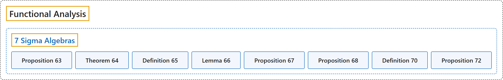

# 7 Sigma Algebras

## Classification

## Glossary

| Term | Definition | 中文翻译 | Source |
|---|---|---|---|
| **7 Sigma Algebras** σ-代数 | (No definition) | （无定义） | [Rodriguez, 2021, lecture 7](https://ocw.mit.edu/courses/18-102-introduction-to-functional-analysis-spring-2021/822b1a9ec1fbf16192b5564621d3b387_MIT18_102s21_lec7.pdf) |
| **Proposition 63** 命题 63 | (pending) | （待补） | [Rodriguez, 2021, lecture 7, Proposition 63](https://ocw.mit.edu/courses/18-102-introduction-to-functional-analysis-spring-2021/822b1a9ec1fbf16192b5564621d3b387_MIT18_102s21_lec7.pdf) |
| **Theorem 64** 定理 64 | (pending) | （待补） | [Rodriguez, 2021, lecture 7, Theorem 64](https://ocw.mit.edu/courses/18-102-introduction-to-functional-analysis-spring-2021/822b1a9ec1fbf16192b5564621d3b387_MIT18_102s21_lec7.pdf) |
| **Definition 65** 定义 65 | (pending) | （待补） | [Rodriguez, 2021, lecture 7, Definition 65](https://ocw.mit.edu/courses/18-102-introduction-to-functional-analysis-spring-2021/822b1a9ec1fbf16192b5564621d3b387_MIT18_102s21_lec7.pdf) |
| **Lemma 66** 引理 66 | (pending) | （待补） | [Rodriguez, 2021, lecture 7, Lemma 66](https://ocw.mit.edu/courses/18-102-introduction-to-functional-analysis-spring-2021/822b1a9ec1fbf16192b5564621d3b387_MIT18_102s21_lec7.pdf) |
| **Proposition 67** 命题 67 | (pending) | （待补） | [Rodriguez, 2021, lecture 7, Proposition 67](https://ocw.mit.edu/courses/18-102-introduction-to-functional-analysis-spring-2021/822b1a9ec1fbf16192b5564621d3b387_MIT18_102s21_lec7.pdf) |
| **Proposition 68** 命题 68 | (pending) | （待补） | [Rodriguez, 2021, lecture 7, Proposition 68](https://ocw.mit.edu/courses/18-102-introduction-to-functional-analysis-spring-2021/822b1a9ec1fbf16192b5564621d3b387_MIT18_102s21_lec7.pdf) |
| **Definition 70** 定义 70 | (pending) | （待补） | [Rodriguez, 2021, lecture 7, Definition 70](https://ocw.mit.edu/courses/18-102-introduction-to-functional-analysis-spring-2021/822b1a9ec1fbf16192b5564621d3b387_MIT18_102s21_lec7.pdf) |
| **Proposition 72** 命题 72 | (pending) | （待补） | [Rodriguez, 2021, lecture 7, Proposition 72](https://ocw.mit.edu/courses/18-102-introduction-to-functional-analysis-spring-2021/822b1a9ec1fbf16192b5564621d3b387_MIT18_102s21_lec7.pdf) |

## References

Rodriguez, C. (2021). *18.102 Introduction to functional analysis: Lecture notes* (Spring 2021). MIT OpenCourseWare. Retrieved October 31, 2026, from <https://ocw.mit.edu/courses/18-102-introduction-to-functional-analysis-spring-2021/>
