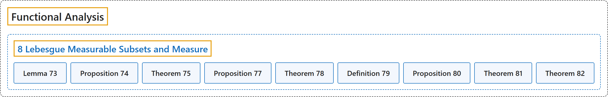

# 8 Lebesgue Measurable Subsets and Measure

## Classification

## Glossary

| Term | Definition | 中文翻译 | Source |
|---|---|---|---|
| **8 Lebesgue Measurable Subsets and Measure** 勒贝格可测子集与测度 | (No definition) | （无定义） | [Rodriguez, 2021, lecture 8](https://ocw.mit.edu/courses/18-102-introduction-to-functional-analysis-spring-2021/1bf275c0667d3e903e4de22b9fb4481b_MIT18_102s21_lec8.pdf) |
| **Lemma 73** 引理 73 | (pending) | （待补） | [Rodriguez, 2021, lecture 8, Lemma 73](https://ocw.mit.edu/courses/18-102-introduction-to-functional-analysis-spring-2021/1bf275c0667d3e903e4de22b9fb4481b_MIT18_102s21_lec8.pdf) |
| **Proposition 74** 命题 74 | (pending) | （待补） | [Rodriguez, 2021, lecture 8, Proposition 74](https://ocw.mit.edu/courses/18-102-introduction-to-functional-analysis-spring-2021/1bf275c0667d3e903e4de22b9fb4481b_MIT18_102s21_lec8.pdf) |
| **Theorem 75** 定理 75 | (pending) | （待补） | [Rodriguez, 2021, lecture 8, Theorem 75](https://ocw.mit.edu/courses/18-102-introduction-to-functional-analysis-spring-2021/1bf275c0667d3e903e4de22b9fb4481b_MIT18_102s21_lec8.pdf) |
| **Proposition 77** 命题 77 | (pending) | （待补） | [Rodriguez, 2021, lecture 8, Proposition 77](https://ocw.mit.edu/courses/18-102-introduction-to-functional-analysis-spring-2021/1bf275c0667d3e903e4de22b9fb4481b_MIT18_102s21_lec8.pdf) |
| **Theorem 78** 定理 78 | (pending) | （待补） | [Rodriguez, 2021, lecture 8, Theorem 78](https://ocw.mit.edu/courses/18-102-introduction-to-functional-analysis-spring-2021/1bf275c0667d3e903e4de22b9fb4481b_MIT18_102s21_lec8.pdf) |
| **Definition 79** 定义 79 | (pending) | （待补） | [Rodriguez, 2021, lecture 8, Definition 79](https://ocw.mit.edu/courses/18-102-introduction-to-functional-analysis-spring-2021/1bf275c0667d3e903e4de22b9fb4481b_MIT18_102s21_lec8.pdf) |
| **Proposition 80** 命题 80 | (pending) | （待补） | [Rodriguez, 2021, lecture 8, Proposition 80](https://ocw.mit.edu/courses/18-102-introduction-to-functional-analysis-spring-2021/1bf275c0667d3e903e4de22b9fb4481b_MIT18_102s21_lec8.pdf) |
| **Theorem 81** 定理 81 | (pending) | （待补） | [Rodriguez, 2021, lecture 8, Theorem 81](https://ocw.mit.edu/courses/18-102-introduction-to-functional-analysis-spring-2021/1bf275c0667d3e903e4de22b9fb4481b_MIT18_102s21_lec8.pdf) |
| **Theorem 82** 定理 82 | (pending) | （待补） | [Rodriguez, 2021, lecture 8, Theorem 82](https://ocw.mit.edu/courses/18-102-introduction-to-functional-analysis-spring-2021/1bf275c0667d3e903e4de22b9fb4481b_MIT18_102s21_lec8.pdf) |

## References

Rodriguez, C. (2021). *18.102 Introduction to functional analysis: Lecture notes* (Spring 2021). MIT OpenCourseWare. Retrieved October 31, 2026, from <https://ocw.mit.edu/courses/18-102-introduction-to-functional-analysis-spring-2021/>
