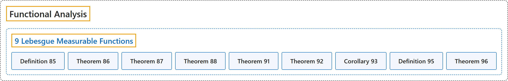

# 9 Lebesgue Measurable Functions

## Classification

## Glossary

| Term | Definition | 中文翻译 | Source |
|---|---|---|---|
| **9 Lebesgue Measurable Functions** 勒贝格可测函数 | (No definition) | （无定义） | [Rodriguez, 2021, lecture 9](https://ocw.mit.edu/courses/18-102-introduction-to-functional-analysis-spring-2021/ede0e9d0812d4b602efafe3ca879b19f_MIT18_102s21_lec9.pdf) |
| **Definition 85** 定义 85 | (pending) | （待补） | [Rodriguez, 2021, lecture 9, Definition 85](https://ocw.mit.edu/courses/18-102-introduction-to-functional-analysis-spring-2021/ede0e9d0812d4b602efafe3ca879b19f_MIT18_102s21_lec9.pdf) |
| **Theorem 86** 定理 86 | (pending) | （待补） | [Rodriguez, 2021, lecture 9, Theorem 86](https://ocw.mit.edu/courses/18-102-introduction-to-functional-analysis-spring-2021/ede0e9d0812d4b602efafe3ca879b19f_MIT18_102s21_lec9.pdf) |
| **Theorem 87** 定理 87 | (pending) | （待补） | [Rodriguez, 2021, lecture 9, Theorem 87](https://ocw.mit.edu/courses/18-102-introduction-to-functional-analysis-spring-2021/ede0e9d0812d4b602efafe3ca879b19f_MIT18_102s21_lec9.pdf) |
| **Theorem 88** 定理 88 | (pending) | （待补） | [Rodriguez, 2021, lecture 9, Theorem 88](https://ocw.mit.edu/courses/18-102-introduction-to-functional-analysis-spring-2021/ede0e9d0812d4b602efafe3ca879b19f_MIT18_102s21_lec9.pdf) |
| **Theorem 91** 定理 91 | (pending) | （待补） | [Rodriguez, 2021, lecture 9, Theorem 91](https://ocw.mit.edu/courses/18-102-introduction-to-functional-analysis-spring-2021/ede0e9d0812d4b602efafe3ca879b19f_MIT18_102s21_lec9.pdf) |
| **Theorem 92** 定理 92 | (pending) | （待补） | [Rodriguez, 2021, lecture 9, Theorem 92](https://ocw.mit.edu/courses/18-102-introduction-to-functional-analysis-spring-2021/ede0e9d0812d4b602efafe3ca879b19f_MIT18_102s21_lec9.pdf) |
| **Corollary 93** 推论 93 | (pending) | （待补） | [Rodriguez, 2021, lecture 9, Corollary 93](https://ocw.mit.edu/courses/18-102-introduction-to-functional-analysis-spring-2021/ede0e9d0812d4b602efafe3ca879b19f_MIT18_102s21_lec9.pdf) |
| **Definition 95** 定义 95 | (pending) | （待补） | [Rodriguez, 2021, lecture 9, Definition 95](https://ocw.mit.edu/courses/18-102-introduction-to-functional-analysis-spring-2021/ede0e9d0812d4b602efafe3ca879b19f_MIT18_102s21_lec9.pdf) |
| **Theorem 96** 定理 96 | (pending) | （待补） | [Rodriguez, 2021, lecture 9, Theorem 96](https://ocw.mit.edu/courses/18-102-introduction-to-functional-analysis-spring-2021/ede0e9d0812d4b602efafe3ca879b19f_MIT18_102s21_lec9.pdf) |

## References

Rodriguez, C. (2021). *18.102 Introduction to functional analysis: Lecture notes* (Spring 2021). MIT OpenCourseWare. Retrieved October 31, 2026, from <https://ocw.mit.edu/courses/18-102-introduction-to-functional-analysis-spring-2021/>
