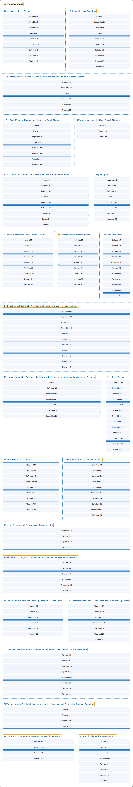

# Functional Analysis

## Classification

## Glossary

| Term | Definition | 中文翻译 | Source |
|---|---|---|---|
| **Functional Analysis** 泛函分析 | (No definition) | （无定义） | [Rodriguez, 2021](https://ocw.mit.edu/courses/18-102-introduction-to-functional-analysis-spring-2021/) |
| **[1 Basic Banach Space Theory](1-basic-banach-space-theory.md)** 巴拿赫空间基本理论 | (No definition) | （无定义） | [Rodriguez, 2021, lecture 1](https://ocw.mit.edu/courses/18-102-introduction-to-functional-analysis-spring-2021/4ae9a5af8622dba3aa37461b71d08407_MIT18_102s21_lec1.pdf) |
| **[2 Bounded Linear Operators](2-bounded-linear-operators.md)** 有界线性算子 | (No definition) | （无定义） | [Rodriguez, 2021, lecture 2](https://ocw.mit.edu/courses/18-102-introduction-to-functional-analysis-spring-2021/22bf2f774fb161776032491568148707_MIT18_102s21_lec2.pdf) |
| **[3 Quotient Spaces, the Baire Category Theorem and the Uniform Boundedness Theorem](3-quotient-spaces-the-baire-category-theorem-and-the-uniform-boundedness-theorem.md)** 商空间、贝尔纲定理与一致有界性定理 | (No definition) | （无定义） | [Rodriguez, 2021, lecture 3](https://ocw.mit.edu/courses/18-102-introduction-to-functional-analysis-spring-2021/f168e97ce4839083e546555a6a994697_MIT18_102s21_lec3.pdf) |
| **[4 The Open Mapping Theorem and the Closed Graph Theorem](4-the-open-mapping-theorem-and-the-closed-graph-theorem.md)** 开映射定理与闭图像定理 | (No definition) | （无定义） | [Rodriguez, 2021, lecture 4](https://ocw.mit.edu/courses/18-102-introduction-to-functional-analysis-spring-2021/038fc32ab9c1bb63a4f29bd9d7c97961_MIT18_102s21_lec4.pdf) |
| **[5 Zorn's Lemma and the Hahn-Banach Theorem](5-zorns-lemma-and-the-hahn-banach-theorem.md)** 佐恩引理与哈恩-巴拿赫定理 | (No definition) | （无定义） | [Rodriguez, 2021, lecture 5](https://ocw.mit.edu/courses/18-102-introduction-to-functional-analysis-spring-2021/06f9cf855f9f5eaa1898f3e684e05cec_MIT18_102s21_lec5.pdf) |
| **[6 The Double Dual and the Outer Measure of a Subset of Real Numbers](6-the-double-dual-and-the-outer-measure-of-a-subset-of-real-numbers.md)** 二次对偶与实数子集的外测度 | (No definition) | （无定义） | [Rodriguez, 2021, lecture 6](https://ocw.mit.edu/courses/18-102-introduction-to-functional-analysis-spring-2021/806234baa2feadee4b54cdf679382257_MIT18_102s21_lec6.pdf) |
| **[7 Sigma Algebras](7-sigma-algebras.md)** σ-代数 | (No definition) | （无定义） | [Rodriguez, 2021, lecture 7](https://ocw.mit.edu/courses/18-102-introduction-to-functional-analysis-spring-2021/822b1a9ec1fbf16192b5564621d3b387_MIT18_102s21_lec7.pdf) |
| **[8 Lebesgue Measurable Subsets and Measure](8-lebesgue-measurable-subsets-and-measure.md)** 勒贝格可测子集与测度 | (No definition) | （无定义） | [Rodriguez, 2021, lecture 8](https://ocw.mit.edu/courses/18-102-introduction-to-functional-analysis-spring-2021/1bf275c0667d3e903e4de22b9fb4481b_MIT18_102s21_lec8.pdf) |
| **[9 Lebesgue Measurable Functions](9-lebesgue-measurable-functions.md)** 勒贝格可测函数 | (No definition) | （无定义） | [Rodriguez, 2021, lecture 9](https://ocw.mit.edu/courses/18-102-introduction-to-functional-analysis-spring-2021/ede0e9d0812d4b602efafe3ca879b19f_MIT18_102s21_lec9.pdf) |
| **[10 Simple Functions](10-simple-functions.md)** 简单函数 | (No definition) | （无定义） | [Rodriguez, 2021, lecture 10](https://ocw.mit.edu/courses/18-102-introduction-to-functional-analysis-spring-2021/ebbbc59aa40252dff3d4ec766c057451_MIT18_102s21_lec10.pdf) |
| **[11 The Lebesgue Integral of a Nonnegative Function and Convergence Theorems](11-the-lebesgue-integral-of-a-nonnegative-function-and-convergence-theorems.md)** 非负函数的勒贝格积分与收敛定理 | (No definition) | （无定义） | [Rodriguez, 2021, lecture 11](https://ocw.mit.edu/courses/18-102-introduction-to-functional-analysis-spring-2021/615c26170233747c081d6dab928f7d91_MIT18_102s21_lec11.pdf) |
| **[12 Lebesgue Integrable Functions, the Lebesgue Integral and the Dominated Convergence Theorem](12-lebesgue-integrable-functions-the-lebesgue-integral-and-the-dominated-convergence-theorem.md)** 勒贝格可积函数、勒贝格积分与控制收敛定理 | (No definition) | （无定义） | [Rodriguez, 2021, lecture 12](https://ocw.mit.edu/courses/18-102-introduction-to-functional-analysis-spring-2021/e407e57ea631a29148ee94afecef7d33_MIT18_102s21_lec12.pdf) |
| **[13 Lp Space Theory](13-lp-space-theory.md)** Lp 空间理论 | (No definition) | （无定义） | [Rodriguez, 2021, lecture 13](https://ocw.mit.edu/courses/18-102-introduction-to-functional-analysis-spring-2021/aad5fcf3b0f85788519a0324258dd296_MIT18_102s21_lec13.pdf) |
| **[14 Basic Hilbert Space Theory](14-basic-hilbert-space-theory.md)** 希尔伯特空间基本理论 | (No definition) | （无定义） | [Rodriguez, 2021, lecture 14](https://ocw.mit.edu/courses/18-102-introduction-to-functional-analysis-spring-2021/721d74b7fa9b3b5427779b6905df95ec_MIT18_102s21_lec14.pdf) |
| **[15 Orthonormal Bases and Fourier Series](15-orthonormal-bases-and-fourier-series.md)** 标准正交基与傅里叶级数 | (No definition) | （无定义） | [Rodriguez, 2021, lecture 15](https://ocw.mit.edu/courses/18-102-introduction-to-functional-analysis-spring-2021/859833f65ee4aec6b0fea35a300d10cd_MIT18_102s21_lec15.pdf) |
| **[16 Fejer's Theorem and Convergence of Fourier Series](16-fejers-theorem-and-convergence-of-fourier-series.md)** 费耶尔定理与傅里叶级数的收敛 | (No definition) | （无定义） | [Rodriguez, 2021, lecture 16](https://ocw.mit.edu/courses/18-102-introduction-to-functional-analysis-spring-2021/eb44436072623f60f8f416875d4b2c11_MIT18_102s21_lec16.pdf) |
| **[17 Minimizers, Orthogonal Complements and the Riesz Representation Theorem](17-minimizers-orthogonal-complements-and-the-riesz-representation-theorem.md)** 极小元、正交补与里斯表示定理 | (No definition) | （无定义） | [Rodriguez, 2021, lecture 17](https://ocw.mit.edu/courses/18-102-introduction-to-functional-analysis-spring-2021/c97549663746d6bc4a379077e067c55b_MIT18_102s21_lec17.pdf) |
| **[18 The Adjoint of a Bounded Linear Operator on a Hilbert Space](18-the-adjoint-of-a-bounded-linear-operator-on-a-hilbert-space.md)** 希尔伯特空间上有界线性算子的伴随 | (No definition) | （无定义） | [Rodriguez, 2021, lecture 18](https://ocw.mit.edu/courses/18-102-introduction-to-functional-analysis-spring-2021/7f23bfc43ee2e1efd238a5384e5b9d51_MIT18_102s21_lec18.pdf) |
| **[19 Compact Subsets of a Hilbert Space and Finite-Rank Operators](19-compact-subsets-of-a-hilbert-space-and-finite-rank-operators.md)** 希尔伯特空间的紧子集与有限秩算子 | (No definition) | （无定义） | [Rodriguez, 2021, lecture 19](https://ocw.mit.edu/courses/18-102-introduction-to-functional-analysis-spring-2021/39ac233d5d7cbfffcdce8086143688f6_MIT18_102s21_lec19.pdf) |
| **[20 Compact Operators and the Spectrum of a Bounded Linear Operator on a Hilbert Space](20-compact-operators-and-the-spectrum-of-a-bounded-linear-operator-on-a-hilbert-space.md)** 紧算子与希尔伯特空间上有界线性算子的谱 | (No definition) | （无定义） | [Rodriguez, 2021, lecture 20](https://ocw.mit.edu/courses/18-102-introduction-to-functional-analysis-spring-2021/9eaaf363541d01d53c330ee7931fc715_MIT18_102s21_lec20.pdf) |
| **[21 The spectrum of Self-Adjoint Operators and the Eigenspaces of Compact Self-Adjoint Operators](21-the-spectrum-of-self-adjoint-operators-and-the-eigenspaces-of-compact-self-adjoint-operators.md)** 自伴算子的谱与紧自伴算子的特征空间 | (No definition) | （无定义） | [Rodriguez, 2021, lecture 21](https://ocw.mit.edu/courses/18-102-introduction-to-functional-analysis-spring-2021/345c4a5141559a4069aeb3105acd8ef3_MIT18_102s21_lec21.pdf) |
| **[22 The Spectral Theorem for a Compact Self-Adjoint Operator](22-the-spectral-theorem-for-a-compact-self-adjoint-operator.md)** 紧自伴算子的谱定理 | (No definition) | （无定义） | [Rodriguez, 2021, lecture 22](https://ocw.mit.edu/courses/18-102-introduction-to-functional-analysis-spring-2021/57596554e180e442c9487f580303147b_MIT18_102s21_lec22.pdf) |
| **[23 The Dirichlet Problem on an Interval](23-the-dirichlet-problem-on-an-interval.md)** 区间上的狄利克雷问题 | (No definition) | （无定义） | [Rodriguez, 2021, lecture 23](https://ocw.mit.edu/courses/18-102-introduction-to-functional-analysis-spring-2021/9f0f59147c3235d57eacca9157faf834_MIT18_102s21_lec23.pdf) |

## References

Rodriguez, C. (2021). *18.102 Introduction to functional analysis: Lecture notes* (Spring 2021). MIT OpenCourseWare. Retrieved October 31, 2026, from <https://ocw.mit.edu/courses/18-102-introduction-to-functional-analysis-spring-2021/>
