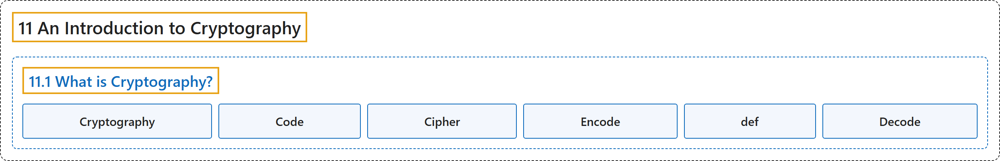

# 11.1 What is Cryptography?

## Classification

## Glossary

| Term | Definition | 中文翻译 | Source |
|---|---|---|---|
| **11.1 What is Cryptography?** 什么是密码学？ | (No definition) | （无定义） | [Crisman, 2024, section 11.1](https://math.gordon.edu/ntic/ntic/section-what-is-crypto.html) |
| **Cryptography** 密码学 | "**Cryptography** is not just the science of making (and breaking) codes, as a dictionary might have it. It is **the *mathematical* analysis of the tools of secrecy**, from both the perspective of someone keeping a secret and that of the person trying to figure it out. Sometimes it is also called *cryptology*, while sometimes that term is reserved for a wider meaning." | **密码学**不只是词典上说的那种编制（和破解）密码的科学。它是**对保密工具的*数学*分析**，既从保守秘密的人的角度，也从试图破解秘密的人的角度。有时它也称为*密码术*（cryptology），不过有时这个词留作更广的含义。 | [Crisman, 2024, section 11.1](https://math.gordon.edu/ntic/ntic/section-what-is-crypto.html#section-what-is-crypto) |
| **Code** 代码 | "Mathematicians use the word **code** to indicate **information is being stored**, reserving the term **cipher** to talk about **a way to protect that information**." | 数学家用**代码**一词表示**信息被存储起来**，而把**密码**一词留给**保护这些信息的方法**。 | [Crisman, 2024, section 11.1](https://math.gordon.edu/ntic/ntic/section-what-is-crypto.html#section-what-is-crypto-3-3) |
| **Cipher** 密码 | "Mathematicians use the word **code** to indicate **information is being stored**, reserving the term **cipher** to talk about **a way to protect that information**." | 数学家用**代码**一词表示**信息被存储起来**，而把**密码**一词留给**保护这些信息的方法**。 | [Crisman, 2024, section 11.1](https://math.gordon.edu/ntic/ntic/section-what-is-crypto.html#section-what-is-crypto-3-3) |
| **Encode** 编码 | "There are many ways to **encode** a message. The easiest one for us (though not used in practice in exactly this way) will be to **simply represent each letter of the English alphabet by an integer from 1 to 26**." | **编码**一条消息的方法有很多。对我们来说最简单的（虽然实际中并不完全这样用）是**把英文字母表的每个字母简单地用 1 到 26 的一个整数表示**。 | [Crisman, 2024, subsection 11.1.1](https://math.gordon.edu/ntic/ntic/section-what-is-crypto.html#subsection-en-decode-2) |
| **def** def | "The code `def` followed by a function name and input variable name (and colon) just tells Sage to **define a new (computer, not necessarily mathematical) function**." | 代码 `def` 后面跟函数名和输入变量名（以及冒号），就是告诉 Sage **定义一个新的（计算机的，不一定是数学的）函数**。 | [Crisman, 2024, Sage note 11.1.1](https://math.gordon.edu/ntic/ntic/section-what-is-crypto.html#sagenote-definitions) |
| **Decode** 解码 | "The process of decoding (or to **decode**) is similar." | 解码（即**解码**这个动作）的过程是类似的。 | [Crisman, 2024, subsection 11.1.1](https://math.gordon.edu/ntic/ntic/section-what-is-crypto.html#subsection-en-decode-9) |

## References

Crisman, K.-D. (2024). *Number theory: In context and interactive* (June 26, 2024 edition). Gordon College. Retrieved October 29, 2026, from <https://math.gordon.edu/ntic/ntic/>
