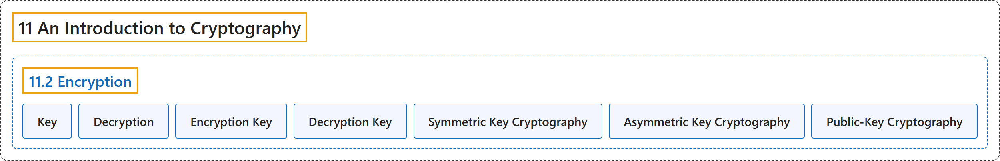

# 11.2 Encryption

## Classification

## Glossary

| Term | Definition | 中文翻译 | Source |
|---|---|---|---|
| **11.2 Encryption** 加密 | "We will spend most of our time talking about **enciphering**, or **encrypting**, messages. Such **encryption** is the difficult part, after all, the details of which we want to keep secret." | 我们大部分时间会讨论如何对消息进行**加密**（enciphering 或 encrypting）。毕竟，这种**加密**是困难的部分，它的细节是我们要保密的。 | [Crisman, 2024, section 11.2](https://math.gordon.edu/ntic/ntic/section-encryption.html#section-encryption-2-1) |
| **Key** 密钥 | "What is cool about modern ciphers is that we actually *expect* that any eavesdropper will know how we do the encryption; they just don’t know the **key**, which is **the specific numbers we use to perform our mathematical encryption**." | 现代密码的妙处在于，我们其实*预料*任何窃听者都知道我们怎样加密；他们只是不知道**密钥**，即**我们用来进行数学加密的那些具体的数**。 | [Crisman, 2024, section 11.2](https://math.gordon.edu/ntic/ntic/section-encryption.html#section-encryption-2-2) |
| **Decryption** 解密 | "**Reversing this process** (hopefully only done by the person you want to receive your message!) is called **decryption**." | **把这个过程反过来**（但愿只有你想让他收到消息的人才这样做！）称为**解密**。 | [Crisman, 2024, section 11.2](https://math.gordon.edu/ntic/ntic/section-encryption.html#section-encryption-2-3) |
| **Encryption Key** 加密密钥 | "Sometimes **you need a different set of numbers to decrypt**, in which case we distinguish between the **encryption key** and the **decryption key**." | 有时**解密需要另一组数**，这时我们区分**加密密钥**和**解密密钥**。 | [Crisman, 2024, section 11.2](https://math.gordon.edu/ntic/ntic/section-encryption.html#section-encryption-2-3) |
| **Decryption Key** 解密密钥 | "Sometimes **you need a different set of numbers to decrypt**, in which case we distinguish between the **encryption key** and the **decryption key**." | 有时**解密需要另一组数**，这时我们区分**加密密钥**和**解密密钥**。 | [Crisman, 2024, section 11.2](https://math.gordon.edu/ntic/ntic/section-encryption.html#section-encryption-2-3) |
| **Symmetric Key Cryptography** 对称密钥密码学 | "In the past, one would usually assume that **both the sender and the receiver keep their keys secret** (seems reasonable!), which is called **symmetric key cryptography**. The symmetry is that both people need to keep it secret." | 过去人们通常假定**发送者和接收者都对各自的密钥保密**（似乎很合理！），这称为**对称密钥密码学**。对称之处在于双方都需要保密。 | [Crisman, 2024, subsection 11.2.1](https://math.gordon.edu/ntic/ntic/section-encryption.html#subsection-simple-ciphers-2) |
| **Asymmetric Key Cryptography** 非对称密钥密码学 | "There exists the possibility that ***everybody* knows the key to encrypt, while only the legitimate person knows how to decrypt**. This is called **asymmetric key cryptography**." | 存在这样的可能：**加密的密钥*人人*都知道，而只有合法的人知道怎样解密**。这称为**非对称密钥密码学**。 | [Crisman, 2024, subsection 11.2.5](https://math.gordon.edu/ntic/ntic/section-encryption.html#subsection-asymmetric-2) |
| **Public-Key Cryptography** 公钥密码学 | "In theory, anyone who wants to send Person XYZ a secure message could use this key, but only Person XYZ can decrypt it – convenient! Such **an implementation of an asymmetric system** is called **public-key** cryptography, although of course it’s only the encryption key that is actually public." | 理论上，任何想给 XYZ 发安全消息的人都可以用这个密钥，但只有 XYZ 能解密，很方便！这种**非对称体系的实现**称为**公钥**密码学，当然，真正公开的只是加密密钥。 | [Crisman, 2024, subsection 11.2.5](https://math.gordon.edu/ntic/ntic/section-encryption.html#subsection-asymmetric-4) |

## References

Crisman, K.-D. (2024). *Number theory: In context and interactive* (June 26, 2024 edition). Gordon College. Retrieved October 29, 2026, from <https://math.gordon.edu/ntic/ntic/>
