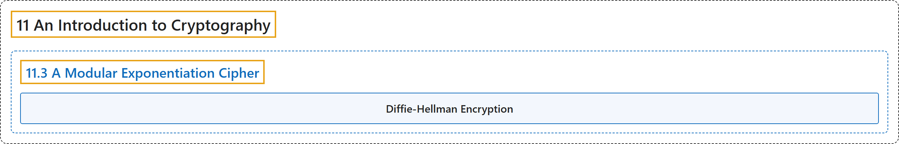

# 11.3 A Modular Exponentiation Cipher

## Classification

## Glossary

| Term | Definition | 中文翻译 | Source |
|---|---|---|---|
| **11.3 A Modular Exponentiation Cipher** 模幂密码 | (No definition) | （无定义） | [Crisman, 2024, section 11.3](https://math.gordon.edu/ntic/ntic/section-diffie-hellman.html) |
| **Diffie-Hellman Encryption** 迪菲-赫尔曼加密 | "To encrypt using this method, do the following. Turn your message into a number $x$. Pick a prime $p$ (presumably greater than $x$). Pick an exponent $e$ such that $\gcd(e,p-1)=1$. **Encrypt to a secret message by taking $m=x^e\text{ (mod }p)$**." | 用这种方法加密，按下面做。把消息变成一个数 $x$。取一个素数 $p$（大概要大于 $x$）。取一个指数 $e$，使 $\gcd(e,p-1)=1$。**取 $m=x^e\text{ (mod }p)$，加密成秘密消息**。 | [Crisman, 2024, Algorithm 11.3.3](https://math.gordon.edu/ntic/ntic/section-diffie-hellman.html#algorithm-diffie-hellman) |

## References

Crisman, K.-D. (2024). *Number theory: In context and interactive* (June 26, 2024 edition). Gordon College. Retrieved October 29, 2026, from <https://math.gordon.edu/ntic/ntic/>
