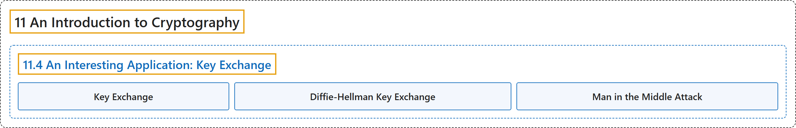

# 11.4 An Interesting Application: Key Exchange

## Classification

## Glossary

| Term | Definition | 中文翻译 | Source |
|---|---|---|---|
| **11.4 An Interesting Application: Key Exchange** 一个有趣的应用：密钥交换 | (No definition) | （无定义） | [Crisman, 2024, section 11.4](https://math.gordon.edu/ntic/ntic/section-key-exchange.html) |
| **Key Exchange** 密钥交换 | "There is **a quite useful application of Diffie-Hellman** called **key exchange**." | 迪菲-赫尔曼方法有一个**很有用的应用**，称为**密钥交换**。 | [Crisman, 2024, section 11.4](https://math.gordon.edu/ntic/ntic/section-key-exchange.html#section-key-exchange-2-1) |
| **Diffie-Hellman Key Exchange** 迪菲-赫尔曼密钥交换 | "First, Alice and Bob jointly pick a big prime $p$ and a base for exponentiation $g$, presumably with $1<g<p$. This doesn’t need to be secret. Now, they each *secretly* choose an exponent; maybe Alice chooses $m$ and Bob chooses $n$. The key step: Each of them exponentiates $g$ to their secret power, modulo $p$. Then they pass off these numbers to each other, and once again exponentiate the *other* person’s number to their *own* secret power, modulo $p$. **The resulting numbers are the same and give the secret key.**" | 首先，Alice 和 Bob 共同选一个大素数 $p$ 和一个求幂的底数 $g$，大概取 $1<g<p$。这些不需要保密。然后，他们各自*秘密地*选一个指数；比如 Alice 选 $m$，Bob 选 $n$。关键一步：每人把 $g$ 求自己的秘密次幂，模 $p$。然后他们把这些数交给对方，再把*对方*的数求自己*本人*的秘密次幂，模 $p$。**得到的两个数相同，就是秘密密钥**。 | [Crisman, 2024, Algorithm 11.4.2](https://math.gordon.edu/ntic/ntic/section-key-exchange.html#algorithm-d-h-key-exchange) |
| **Man in the Middle Attack** 中间人攻击 | "Eve can in this situation add *her own* exponent, $\ell$, to the game, so that **she pretends to have secret key $g^{m\ell}$ with Alice and secret key $g^{n\ell}$ with Bob**. Both of their keys’ security is now compromised. Such a situation is historically known as a “**Man in the Middle**” attack." | 这时 Eve 可以把*她自己的*指数 $\ell$ 加进来，从而**假装与 Alice 共有秘密密钥 $g^{m\ell}$，与 Bob 共有秘密密钥 $g^{n\ell}$**。两人密钥的安全都被破坏了。这种情形历来称为“**中间人**”攻击。 | [Crisman, 2024, subsection 11.4.2](https://math.gordon.edu/ntic/ntic/section-key-exchange.html#subsection-man-middle-5) |

## References

Crisman, K.-D. (2024). *Number theory: In context and interactive* (June 26, 2024 edition). Gordon College. Retrieved October 29, 2026, from <https://math.gordon.edu/ntic/ntic/>
