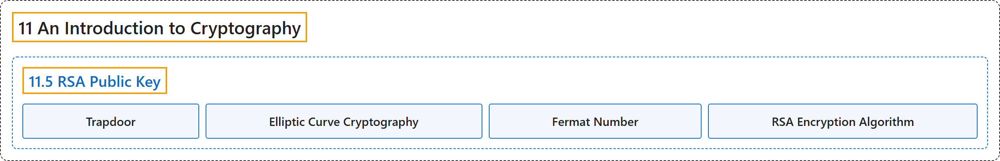

# 11.5 RSA Public Key

## Classification

## Glossary

| Term | Definition | 中文翻译 | Source |
|---|---|---|---|
| **11.5 RSA Public Key** RSA 公钥 | (No definition) | （无定义） | [Crisman, 2024, section 11.5](https://math.gordon.edu/ntic/ntic/section-rsa-intro.html) |
| **Trapdoor** 陷门 | "Recall that this means we have an encryption key that is **easy for anybody at all to use, but is very difficult to undo unless you know the secret**. (Sometimes this is called a **trapdoor** system, because it’s easy to fall in but it’s hard to get back out unless you know where the secret passageway is!)" | 回忆一下，这意味着我们有一个加密密钥，**任何人都很容易使用，但除非知道秘密，否则很难逆转**。（有时这称为**陷门**体系，因为掉进去容易，但除非知道秘密通道在哪里，否则很难出来！） | [Crisman, 2024, section 11.5](https://math.gordon.edu/ntic/ntic/section-rsa-intro.html#section-rsa-intro-4-3) |
| **Elliptic Curve Cryptography** 椭圆曲线密码学 | "With the advent of mobile devices, it turns out that this has once again become a big issue, so much so that even RSA or similar methods are being replaced with **more sophisticated ones involving curves like those coming from the Mordell equation** (recall Section 15.3), known as **elliptic curves**." | 随着移动设备的出现，这又成了大问题，以至于连 RSA 或类似的方法也正在被**涉及曲线（如来自莫德尔方程的那些曲线，见 15.3 节）的更精巧的方法**取代，这种曲线称为**椭圆曲线**。 | [Crisman, 2024, subsection 11.5.1](https://math.gordon.edu/ntic/ntic/section-rsa-intro.html#subsection-rsa-background-2) |
| **Fermat Number** 费马数 | "As an example, in the early 1600s, Fermat believed **$2^{32}+1$** was prime." | 例如，17 世纪初，费马相信 **$2^{32}+1$** 是素数。 | [Crisman, 2024, subsection 11.5.1](https://math.gordon.edu/ntic/ntic/section-rsa-intro.html#subsection-rsa-background-8) |
| **RSA Encryption Algorithm** RSA 加密算法 | "In order to encrypt a message $x$ via RSA with public key $(n,e)$, you do **$x^e\text{ (mod }n)$**. In order for the owner of the key to decrypt a message $m$, they do **$m^{e^{-1}}=m^f\text{ (mod }n)$** for any $f$ solving $ef\equiv 1\text{ (mod }\phi(n))$." | 用公钥 $(n,e)$ 通过 RSA 加密消息 $x$，计算 **$x^e\text{ (mod }n)$**。密钥的主人要解密消息 $m$，就计算 **$m^{e^{-1}}=m^f\text{ (mod }n)$**，其中 $f$ 是满足 $ef\equiv 1\text{ (mod }\phi(n))$ 的任意解。 | [Crisman, 2024, Algorithm 11.5.5](https://math.gordon.edu/ntic/ntic/section-rsa-intro.html#algorithm-rsa) |

## References

Crisman, K.-D. (2024). *Number theory: In context and interactive* (June 26, 2024 edition). Gordon College. Retrieved October 29, 2026, from <https://math.gordon.edu/ntic/ntic/>
