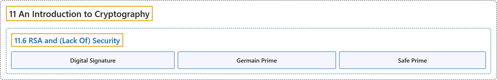

# 11.6 RSA and (Lack Of) Security

## Classification

## Glossary

| Term | Definition | 中文翻译 | Source |
|---|---|---|---|
| **11.6 RSA and (Lack Of) Security** RSA 与（缺乏）安全性 | (No definition) | （无定义） | [Crisman, 2024, section 11.6](https://math.gordon.edu/ntic/ntic/section-rsa-security.html) |
| **Digital Signature** 数字签名 | "Naturally, implementing this is somewhat more complex in real life (e.g. padding is used), but it is one major **digital signing method** implemented on many secure systems." | 当然，实际中实现起来要复杂一些（比如要用填充），但它是许多安全系统采用的一种主要的**数字签名方法**。 | [Crisman, 2024, subsection 11.6.1](https://math.gordon.edu/ntic/ntic/section-rsa-security.html#subsection-beat-middle-12) |
| **Germain Prime** 热尔曼素数 | "Going backwards, we are looking for **prime numbers $p',q'$ such that $2p'+1,2q'+1$ are also prime**, and then we use $p=2p'+1$ and $q=2q'+1$ in RSA, finding an exponent that has big order in $U_{\phi(n)}$. In this example, $p'=5$ and $q'=3$. Such primes $p'$ and $q'$ are called **Germain primes**, for French mathematician Sophie Germain." | 反过来，我们要找**素数 $p',q'$，使 $2p'+1,2q'+1$ 也是素数**，然后在 RSA 中用 $p=2p'+1$ 和 $q=2q'+1$，找一个在 $U_{\phi(n)}$ 中阶很大的指数。在这个例子里，$p'=5$，$q'=3$。这样的素数 $p'$ 和 $q'$ 称为**热尔曼素数**，以法国数学家热尔曼（Sophie Germain）命名。 | [Crisman, 2024, subsection 11.6.4](https://math.gordon.edu/ntic/ntic/section-rsa-security.html#subsection-solution-germain-8) |
| **Safe Prime** 安全素数 | "Such primes $p'$ and $q'$ are called Germain primes, for French mathematician Sophie Germain. **The primes $p$ and $q$** are then called **safe primes**, presumably because they might be ‘safe’ to use under some circumstances." | 这样的素数 $p'$ 和 $q'$ 称为热尔曼素数，以法国数学家热尔曼（Sophie Germain）命名。**素数 $p$ 和 $q$** 则称为**安全素数**，大概是因为在某些情形下用它们可能是“安全”的。 | [Crisman, 2024, subsection 11.6.4](https://math.gordon.edu/ntic/ntic/section-rsa-security.html#subsection-solution-germain-8) |

## References

Crisman, K.-D. (2024). *Number theory: In context and interactive* (June 26, 2024 edition). Gordon College. Retrieved October 29, 2026, from <https://math.gordon.edu/ntic/ntic/>
