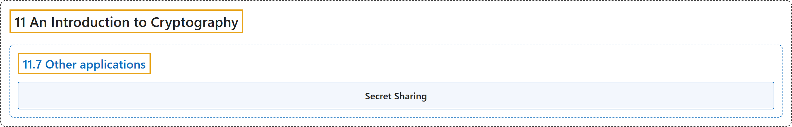

# 11.7 Other applications

## Classification

## Glossary

| Term | Definition | 中文翻译 | Source |
|---|---|---|---|
| **11.7 Other applications** 其他应用 | (No definition) | （无定义） | [Crisman, 2024, section 11.7](https://math.gordon.edu/ntic/ntic/section-other-crypto.html) |
| **Secret Sharing** 秘密共享 | "Suppose the trade secret is digitally represented as a large number $K$. Here are steps to **create three different keys so that access to any two of these will allow access to $K$**." | 设商业秘密以数字形式表示为一个大数 $K$。下面是**生成三个不同密钥、使得拿到其中任意两个就能得到 $K$** 的步骤。 | [Crisman, 2024, Algorithm 11.7.1](https://math.gordon.edu/ntic/ntic/section-other-crypto.html#algorithm-secret-sharing) |

## References

Crisman, K.-D. (2024). *Number theory: In context and interactive* (June 26, 2024 edition). Gordon College. Retrieved October 29, 2026, from <https://math.gordon.edu/ntic/ntic/>
