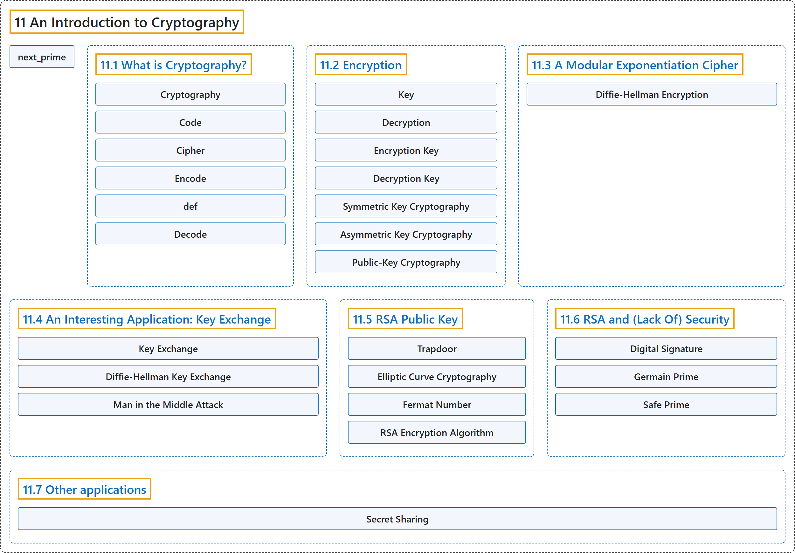

# 11 An Introduction to Cryptography

## Classification

## Glossary

| Term | Definition | 中文翻译 | Source |
|---|---|---|---|
| **11 An Introduction to Cryptography** 密码学导论 | (No definition) | （无定义） | [Crisman, 2024, chapter 11](https://math.gordon.edu/ntic/ntic/chapter-cryptography.html) |
| **next_prime** next_prime | "By ‘huge’ I mean something substantially bigger than **the output of the following commands**." | 我说的“巨大”，是指比**下面这些命令的输出**大得多的数。 | [Crisman, 2024, chapter 11](https://math.gordon.edu/ntic/ntic/chapter-cryptography.html#chapter-cryptography-2-2) |
| **[11.1 What is Cryptography?](11-1-what-is-cryptography.md)** 什么是密码学？ | (No definition) | （无定义） | [Crisman, 2024, section 11.1](https://math.gordon.edu/ntic/ntic/section-what-is-crypto.html) |
| **[11.2 Encryption](11-2-encryption.md)** 加密 | (No definition) | （无定义） | [Crisman, 2024, section 11.2](https://math.gordon.edu/ntic/ntic/section-encryption.html) |
| **[11.3 A Modular Exponentiation Cipher](11-3-a-modular-exponentiation-cipher.md)** 模幂密码 | (No definition) | （无定义） | [Crisman, 2024, section 11.3](https://math.gordon.edu/ntic/ntic/section-diffie-hellman.html) |
| **[11.4 An Interesting Application: Key Exchange](11-4-an-interesting-application-key-exchange.md)** 一个有趣的应用：密钥交换 | (No definition) | （无定义） | [Crisman, 2024, section 11.4](https://math.gordon.edu/ntic/ntic/section-key-exchange.html) |
| **[11.5 RSA Public Key](11-5-rsa-public-key.md)** RSA 公钥 | (No definition) | （无定义） | [Crisman, 2024, section 11.5](https://math.gordon.edu/ntic/ntic/section-rsa-intro.html) |
| **[11.6 RSA and (Lack Of) Security](11-6-rsa-and-lack-of-security.md)** RSA 与（缺乏）安全性 | (No definition) | （无定义） | [Crisman, 2024, section 11.6](https://math.gordon.edu/ntic/ntic/section-rsa-security.html) |
| **[11.7 Other applications](11-7-other-applications.md)** 其他应用 | (No definition) | （无定义） | [Crisman, 2024, section 11.7](https://math.gordon.edu/ntic/ntic/section-other-crypto.html) |

## References

Crisman, K.-D. (2024). *Number theory: In context and interactive* (June 26, 2024 edition). Gordon College. Retrieved October 29, 2026, from <https://math.gordon.edu/ntic/ntic/>
