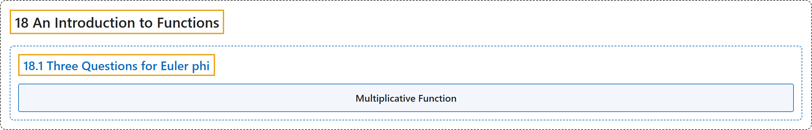

# 18.1 Three Questions for Euler phi

## Classification

## Glossary

| Term | Definition | 中文翻译 | Source |
|---|---|---|---|
| **18.1 Three Questions for Euler phi** 关于欧拉 φ 函数的三个问题 | (No definition) | （无定义） | [Crisman, 2024, section 18.1](https://math.gordon.edu/ntic/ntic/section-function-questions.html) |
| **Multiplicative Function** 积性函数 | "We say that $f(n)$ is **multiplicative** if **$f(m)f(n)=f(mn)\text{ when }m,n\text{ are coprime.}$**" | 若 **$f(m)f(n)=f(mn)\text{ when }m,n\text{ are coprime.}$**（$m,n$ 互素时），就说 $f(n)$ 是**积性的**。 | [Crisman, 2024, Definition 18.1.2](https://math.gordon.edu/ntic/ntic/section-function-questions.html#definition-multiplicative) |

## References

Crisman, K.-D. (2024). *Number theory: In context and interactive* (June 26, 2024 edition). Gordon College. Retrieved October 29, 2026, from <https://math.gordon.edu/ntic/ntic/>
