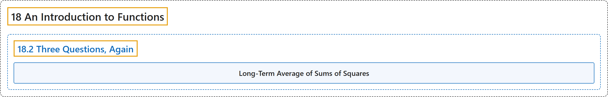

# 18.2 Three Questions, Again

## Classification

## Glossary

| Term | Definition | 中文翻译 | Source |
|---|---|---|---|
| **18.2 Three Questions, Again** 再谈三个问题 | (No definition) | （无定义） | [Crisman, 2024, section 18.2](https://math.gordon.edu/ntic/ntic/section-func-qs-again.html) |
| **Long-Term Average of Sums of Squares** 平方和表示数的长期平均 | "**The average number of representations of a positive integer as a sum of squares is $\pi$.**" | **正整数表示为平方和的方法数的平均值是 $\pi$**。 | [Crisman, 2024, Fact 18.2.9](https://math.gordon.edu/ntic/ntic/section-func-qs-again.html#fact-average-sum-squares) |

## References

Crisman, K.-D. (2024). *Number theory: In context and interactive* (June 26, 2024 edition). Gordon College. Retrieved October 29, 2026, from <https://math.gordon.edu/ntic/ntic/>
