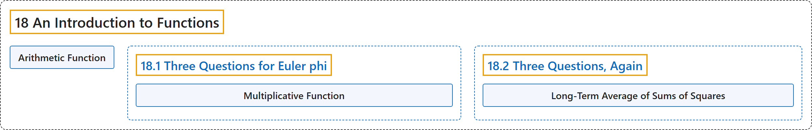

# 18 An Introduction to Functions

## Classification

## Glossary

| Term | Definition | 中文翻译 | Source |
|---|---|---|---|
| **18 An Introduction to Functions** 函数导论 | (No definition) | （无定义） | [Crisman, 2024, chapter 18](https://math.gordon.edu/ntic/ntic/chapter-intro-functions.html) |
| **Arithmetic Function** 算术函数 | "The Euler function, like many we have seen and will see, is an example of an **arithmetic function**. An arithmetic function is **a function with the positive integers as its domain, usually going to integer, real, or complex values**." | 欧拉函数和我们见过、将要见到的许多函数一样，是**算术函数**的一个例子。算术函数是**定义域为正整数、通常取整数、实数或复数值的函数**。 | [Crisman, 2024, chapter 18](https://math.gordon.edu/ntic/ntic/chapter-intro-functions.html#chapter-intro-functions-2-4) |
| **[18.1 Three Questions for Euler phi](18-1-three-questions-for-euler-phi.md)** 关于欧拉 φ 函数的三个问题 | (No definition) | （无定义） | [Crisman, 2024, section 18.1](https://math.gordon.edu/ntic/ntic/section-function-questions.html) |
| **[18.2 Three Questions, Again](18-2-three-questions-again.md)** 再谈三个问题 | (No definition) | （无定义） | [Crisman, 2024, section 18.2](https://math.gordon.edu/ntic/ntic/section-func-qs-again.html) |

## References

Crisman, K.-D. (2024). *Number theory: In context and interactive* (June 26, 2024 edition). Gordon College. Retrieved October 29, 2026, from <https://math.gordon.edu/ntic/ntic/>
