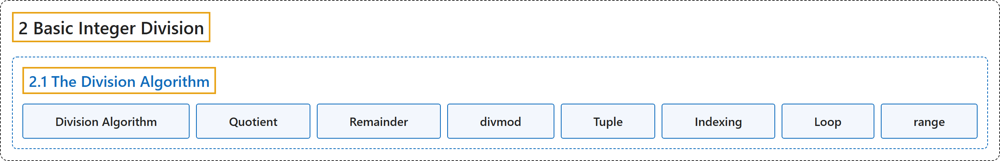

# 2.1 The Division Algorithm

## Classification

## Glossary

| Term | Definition | 中文翻译 | Source |
|---|---|---|---|
| **2.1 The Division Algorithm** 带余除法 | (No definition) | （无定义） | [Crisman, 2024, section 2.1](https://math.gordon.edu/ntic/ntic/section-div-alg.html) |
| **Division Algorithm** 带余除法 | "For $a,b\in\mathbb{Z}$ and $b>0$, **we can always write $a=qb+r$ with $0\leq r<b$ and $q$ an integer**. Moreover, given $a,b$ **there is only one pair $q,r$ which satisfy these constraints**." | 对 $a,b\in\mathbb{Z}$ 且 $b>0$，**总可以写成 $a=qb+r$，其中 $0\leq r<b$，$q$ 是整数**。而且，给定 $a,b$，**满足这些约束的 $q,r$ 只有一对**。 | [Crisman, 2024, Theorem 2.1.1](https://math.gordon.edu/ntic/ntic/section-div-alg.html#thm-div-alg) |
| **Quotient** 商 | "For $a,b\in\mathbb{Z}$ and $b>0$, we can always write $a=qb+r$ with $0\leq r<b$ and $q$ an integer. Moreover, given $a,b$ there is only one pair $q,r$ which satisfy these constraints. We call **the first element $q$** the **quotient**, and the second one $r$ the remainder." | 对 $a,b\in\mathbb{Z}$ 且 $b>0$，总可以写成 $a=qb+r$，其中 $0\leq r<b$，$q$ 是整数。而且，给定 $a,b$，满足这些约束的 $q,r$ 只有一对。我们把**第一个元素 $q$** 称为**商**，第二个 $r$ 称为余数。 | [Crisman, 2024, Theorem 2.1.1](https://math.gordon.edu/ntic/ntic/section-div-alg.html#thm-div-alg) |
| **Remainder** 余数 | "For $a,b\in\mathbb{Z}$ and $b>0$, we can always write $a=qb+r$ with $0\leq r<b$ and $q$ an integer. Moreover, given $a,b$ there is only one pair $q,r$ which satisfy these constraints. We call the first element $q$ the quotient, and **the second one $r$** the **remainder**." | 对 $a,b\in\mathbb{Z}$ 且 $b>0$，总可以写成 $a=qb+r$，其中 $0\leq r<b$，$q$ 是整数。而且，给定 $a,b$，满足这些约束的 $q,r$ 只有一对。我们把第一个元素 $q$ 称为商，**第二个 $r$** 称为**余数**。 | [Crisman, 2024, Theorem 2.1.1](https://math.gordon.edu/ntic/ntic/section-div-alg.html#thm-div-alg) |
| **divmod** divmod | "First, note that **the answer to `divmod`** came in parentheses, a so-called tuple data type." | 首先注意，**`divmod` 的结果**是放在圆括号里给出的，即所谓的元组数据类型。 | [Crisman, 2024, Sage note 2.1.2](https://math.gordon.edu/ntic/ntic/section-div-alg.html#sagenote-count-begins-zero) |
| **Tuple** 元组 | "First, note that the answer to `divmod` **came in parentheses**, a so-called **tuple** data type." | 首先注意，`divmod` 的结果**是放在圆括号里给出的**，即所谓的**元组**数据类型。 | [Crisman, 2024, Sage note 2.1.2](https://math.gordon.edu/ntic/ntic/section-div-alg.html#sagenote-count-begins-zero) |
| **Indexing** 索引 | "To access the first and second parts of the answer (the quotient and remainder), **we use square brackets**, asking for the *0th and 1st* parts of the tuple `(9702,18)`! (This operation is called **indexing**.)" | 要取得结果的第一和第二部分（商和余数），**我们用方括号**，取元组 `(9702,18)` 的*第 0 和第 1* 部分！（这个操作称为**索引**。） | [Crisman, 2024, Sage note 2.1.2](https://math.gordon.edu/ntic/ntic/section-div-alg.html#sagenote-count-begins-zero) |
| **Loop** 循环 | "The syntax `for i in [0..10]:` just means **we want to do the next command for integers from 0 to 10**. Such **a repetition** is called a **loop**." | 语法 `for i in [0..10]:` 的意思就是**我们要对从 0 到 10 的整数执行下一条命令**。这样的**重复**称为**循环**。 | [Crisman, 2024, Sage note 2.1.3](https://math.gordon.edu/ntic/ntic/section-div-alg.html#sagenote-loops) |
| **range** range | "Another way Python uses **to generate the list of different input** is the `range` command; try substituting `range(11)` for `[0..10]` in the Sage cell above." | Python **生成不同输入列表**的另一种方法是 `range` 命令；试着在上面的 Sage 单元中用 `range(11)` 替换 `[0..10]`。 | [Crisman, 2024, Sage note 2.1.3](https://math.gordon.edu/ntic/ntic/section-div-alg.html#sagenote-loops) |

## References

Crisman, K.-D. (2024). *Number theory: In context and interactive* (June 26, 2024 edition). Gordon College. Retrieved October 29, 2026, from <https://math.gordon.edu/ntic/ntic/>
