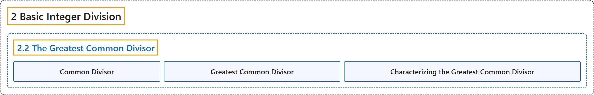

# 2.2 The Greatest Common Divisor

## Classification

## Glossary

| Term | Definition | 中文翻译 | Source |
|---|---|---|---|
| **2.2 The Greatest Common Divisor** 最大公约数 | (No definition) | （无定义） | [Crisman, 2024, section 2.2](https://math.gordon.edu/ntic/ntic/section-gcd.html) |
| **Common Divisor** 公因数 | "If we consider the various divisors of two numbers $a$ and $b$, we say that $d$ is a **common divisor** of $a$ and $b$ if **$d\mid a$ and $d\mid b$**." | 考虑两个数 $a$ 与 $b$ 的各个因数时，若 **$d\mid a$ 且 $d\mid b$**，则称 $d$ 是 $a$ 与 $b$ 的**公因数**。 | [Crisman, 2024, Definition 2.2.1](https://math.gordon.edu/ntic/ntic/section-gcd.html#definition-gcd) |
| **Greatest Common Divisor** 最大公约数 | "If we consider the various divisors of two numbers $a$ and $b$, we say that $d$ is a common divisor of $a$ and $b$ if $d\mid a$ and $d\mid b$. If $d$ is **the biggest such common divisor**, it is called the **greatest common divisor**, or **gcd**, of $a$ and $b$, written $d=\gcd(a,b)$." | 考虑两个数 $a$ 与 $b$ 的各个因数时，若 $d\mid a$ 且 $d\mid b$，则称 $d$ 是 $a$ 与 $b$ 的公因数。若 $d$ 是**最大的这样的公因数**，就称它为 $a$ 与 $b$ 的**最大公约数**（**gcd**），记作 $d=\gcd(a,b)$。 | [Crisman, 2024, Definition 2.2.1](https://math.gordon.edu/ntic/ntic/section-gcd.html#definition-gcd) |
| **Characterizing the Greatest Common Divisor** 最大公约数的刻画 | "Let $a$ and $b$ be integers, not both zero. Then the greatest common divisor of $a$ and $b$ is **all of the following**: **The largest integer $d$ such that $d\mid a$ and $d\mid b$.** (This is Definition 2.2.1.) **The number achieved by applying the Euclidean algorithm (a repeated division algorithm) to $a$ and $b$.** (See Section 2.3.) **The smallest positive number which can be written as $ax+by$ for some integers $x$ and $y$.** (See Section 2.4 and Subsection 2.4.2.)" | 设 $a$ 与 $b$ 是不全为零的整数。则 $a$ 与 $b$ 的最大公约数**同时是下面三者**：**使 $d\mid a$ 且 $d\mid b$ 的最大整数 $d$。**（即定义 2.2.1。）**对 $a$ 与 $b$ 施行欧几里得算法（反复做带余除法）得到的数。**（见 2.3 节。）**能对某些整数 $x$ 与 $y$ 写成 $ax+by$ 的最小正数。**（见 2.4 节和 2.4.2 小节。） | [Crisman, 2024, Theorem 2.2.4](https://math.gordon.edu/ntic/ntic/section-gcd.html#theorem-gcd) |

## References

Crisman, K.-D. (2024). *Number theory: In context and interactive* (June 26, 2024 edition). Gordon College. Retrieved October 29, 2026, from <https://math.gordon.edu/ntic/ntic/>
