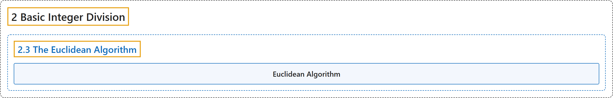

# 2.3 The Euclidean Algorithm

## Classification

## Glossary

| Term | Definition | 中文翻译 | Source |
|---|---|---|---|
| **2.3 The Euclidean Algorithm** 欧几里得算法 | (No definition) | （无定义） | [Crisman, 2024, section 2.3](https://math.gordon.edu/ntic/ntic/section-euclid-alg.html) |
| **Euclidean Algorithm** 欧几里得算法 | "The **Euclidean algorithm** says that to find the gcd of $a$ and $b$, one **performs the division algorithm until zero is the remainder, each time replacing the previous divisor by the previous remainder, and the previous number to be divided (sometimes called dividend) by the previous divisor**. **The last non-zero remainder is the gcd.**" | **欧几里得算法**是说：要求 $a$ 与 $b$ 的最大公约数，就**反复做带余除法直到余数为零，每次用上一个余数替换上一个除数，用上一个除数替换上一个被除的数（有时称为被除数）**。**最后一个非零余数就是最大公约数。** | [Crisman, 2024, section 2.3](https://math.gordon.edu/ntic/ntic/section-euclid-alg.html#section-euclid-alg-3) |

## References

Crisman, K.-D. (2024). *Number theory: In context and interactive* (June 26, 2024 edition). Gordon College. Retrieved October 29, 2026, from <https://math.gordon.edu/ntic/ntic/>
