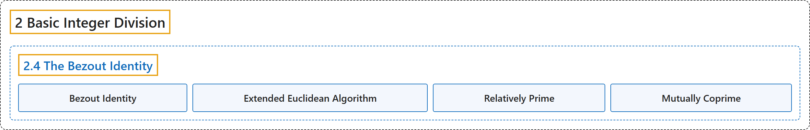

# 2.4 The Bezout Identity

## Classification

## Glossary

| Term | Definition | 中文翻译 | Source |
|---|---|---|---|
| **2.4 The Bezout Identity** 裴蜀等式 | (No definition) | （无定义） | [Crisman, 2024, section 2.4](https://math.gordon.edu/ntic/ntic/section-bezout-id.html) |
| **Bezout Identity** 裴蜀等式 | "**A representation of the gcd $d$ of $a$ and $b$ as a linear combination $ax+by=d$ of the original numbers** is called an instance of the **Bezout identity**. (This representation is not unique.)" | 把 $a$ 与 $b$ 的最大公约数 $d$ **表示成原来两数的线性组合 $ax+by=d$**，这样的一个表示称为**裴蜀等式**的一个实例。（这种表示不唯一。） | [Crisman, 2024, Definition 2.4.1](https://math.gordon.edu/ntic/ntic/section-bezout-id.html#definition-bezout-id) |
| **Extended Euclidean Algorithm** 扩展欧几里得算法 | "This question of **the Bezout identity** is implemented in Sage as `xgcd(a,b)`, because this is also known as the **e*X*tended Euclidean algorithm**." | **裴蜀等式**这个问题在 Sage 中实现为 `xgcd(a,b)`，因为它也称为**扩展（e*X*tended）欧几里得算法**。 | [Crisman, 2024, subsection 2.4.1](https://math.gordon.edu/ntic/ntic/section-bezout-id.html#subsection-bezout-id-8) |
| **Relatively Prime** 互素 | "If **the greatest common divisor of two numbers is one**, we call them **relatively prime** numbers or **coprime** numbers." | 若**两个数的最大公约数是一**，就称它们是**互素**的数，或**互质**的数。 | [Crisman, 2024, Definition 2.4.9](https://math.gordon.edu/ntic/ntic/section-bezout-id.html#definition-relatively-prime) |
| **Mutually Coprime** 两两互素 | "Later, we will need to have a term for the situation where, in a collection of several integers, **all possible pairs are relatively prime**. We will call this **mutually coprime**, **coprime in pairs**, or an analogous term." | 后面我们需要一个术语来表示这种情形：在若干个整数组成的一组数中，**所有可能的数对都互素**。我们称之为**两两互素**（mutually coprime，或 coprime in pairs），或类似的说法。 | [Crisman, 2024, Definition 2.4.9](https://math.gordon.edu/ntic/ntic/section-bezout-id.html#definition-relatively-prime) |

## References

Crisman, K.-D. (2024). *Number theory: In context and interactive* (June 26, 2024 edition). Gordon College. Retrieved October 29, 2026, from <https://math.gordon.edu/ntic/ntic/>
