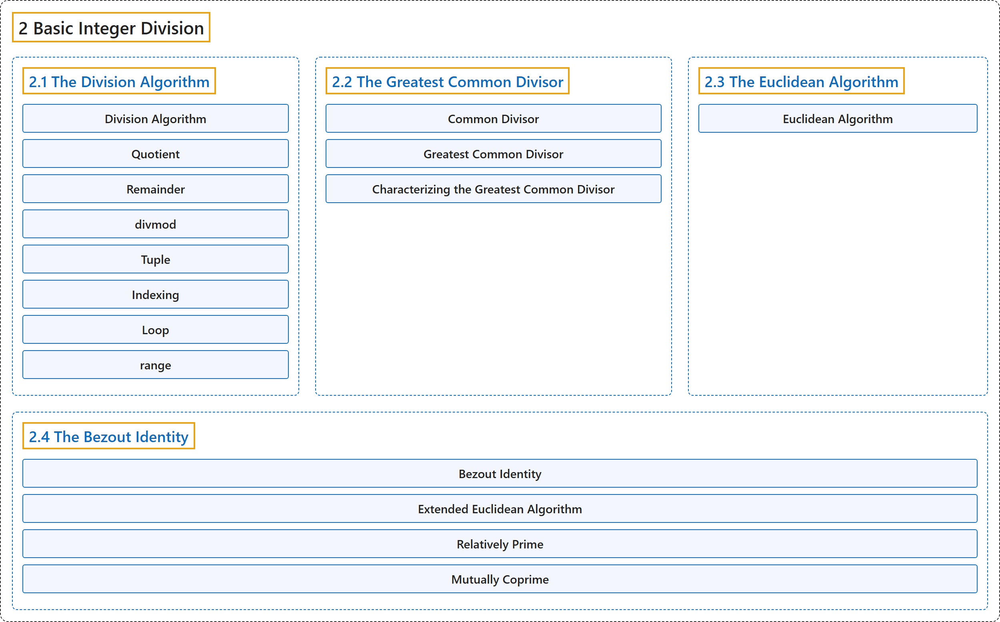

# 2 Basic Integer Division

## Classification

## Glossary

| Term | Definition | 中文翻译 | Source |
|---|---|---|---|
| **2 Basic Integer Division** 整数除法基础 | (No definition) | （无定义） | [Crisman, 2024, chapter 2](https://math.gordon.edu/ntic/ntic/chapter-basic-integers.html) |
| **[2.1 The Division Algorithm](2-1-the-division-algorithm.md)** 带余除法 | (No definition) | （无定义） | [Crisman, 2024, section 2.1](https://math.gordon.edu/ntic/ntic/section-div-alg.html) |
| **[2.2 The Greatest Common Divisor](2-2-the-greatest-common-divisor.md)** 最大公约数 | (No definition) | （无定义） | [Crisman, 2024, section 2.2](https://math.gordon.edu/ntic/ntic/section-gcd.html) |
| **[2.3 The Euclidean Algorithm](2-3-the-euclidean-algorithm.md)** 欧几里得算法 | (No definition) | （无定义） | [Crisman, 2024, section 2.3](https://math.gordon.edu/ntic/ntic/section-euclid-alg.html) |
| **[2.4 The Bezout Identity](2-4-the-bezout-identity.md)** 裴蜀等式 | (No definition) | （无定义） | [Crisman, 2024, section 2.4](https://math.gordon.edu/ntic/ntic/section-bezout-id.html) |

## References

Crisman, K.-D. (2024). *Number theory: In context and interactive* (June 26, 2024 edition). Gordon College. Retrieved October 29, 2026, from <https://math.gordon.edu/ntic/ntic/>
