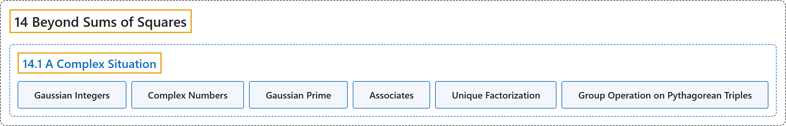

# 14.1 A Complex Situation

## Classification

## Glossary

| Term | Definition | 中文翻译 | Source |
|---|---|---|---|
| **14.1 A Complex Situation** 复数情形 | (No definition) | （无定义） | [Crisman, 2024, section 14.1](https://math.gordon.edu/ntic/ntic/section-complex-sums.html) |
| **Gaussian Integers** 高斯整数 | "The **Gaussian Integers** $\mathbb{Z}[i]$ may be defined as **the set $\mathbb{Z}[i]=\{a+bi\mid a,b\in\mathbb{Z}\}$**" | **高斯整数** $\mathbb{Z}[i]$ 可以定义为**集合 $\mathbb{Z}[i]=\{a+bi\mid a,b\in\mathbb{Z}\}$** | [Crisman, 2024, Definition 14.1.2](https://math.gordon.edu/ntic/ntic/section-complex-sums.html#definition-gaussian-integers) |
| **Complex Numbers** 复数 | "This does assume that we can have **such a symbol $i$ with $i^2=-1$**; typically this is considered to thus be a subset of the so-called **complex numbers**, denoted $\mathbb{C}$." | 这确实假定了我们可以有**这样一个满足 $i^2=-1$ 的符号 $i$**；通常认为这是所谓**复数**（记作 $\mathbb{C}$）的一个子集。 | [Crisman, 2024, Definition 14.1.2](https://math.gordon.edu/ntic/ntic/section-complex-sums.html#definition-gaussian-integers) |
| **Gaussian Prime** 高斯素数 | "**Prime numbers in the Gaussian integers**, or **Gaussian primes**, are of three possible forms:" | **高斯整数中的素数**，即**高斯素数**，有三种可能的形式： | [Crisman, 2024, Fact 14.1.5](https://math.gordon.edu/ntic/ntic/section-complex-sums.html#fact-gaussian-primes) |
| **Associates** 相伴元 | "In Figure 14.1.4 this means that not only $3\pm 2i$, but also $-3\pm 2i$, $2\pm 3i$, and $-2\pm 3i$ are *all* Gaussian primes. This is related to the notion of **associates** in ring theory; see also the end of this subsection." | 在图 14.1.4 中，这意味着不仅 $3\pm 2i$，而且 $-3\pm 2i$、$2\pm 3i$ 和 $-2\pm 3i$ *全都*是高斯素数。这与环论中**相伴元**的概念有关；另见本小节末尾。 | [Crisman, 2024, subsection 14.1.2](https://math.gordon.edu/ntic/ntic/section-complex-sums.html#subsection-revisit-norm-4) |
| **Unique Factorization** 唯一分解 | "Crucially, I am skipping whether we actually have **unique factorization** in $\mathbb{Z}[i]$. This is true, and is used below in Fact 14.1.8, but properly belongs in an abstract algebra course." | 关键在于，我跳过了 $\mathbb{Z}[i]$ 中是否真的有**唯一分解**。这是成立的，下面的事实 14.1.8 就用到了它，但它其实属于抽象代数课程。 | [Crisman, 2024, subsection 14.1.2](https://math.gordon.edu/ntic/ntic/section-complex-sums.html#subsection-revisit-norm-15) |
| **Group Operation on Pythagorean Triples** 毕达哥拉斯三元组上的群运算 | "Most remarkably, a variant of this operation applied to *primitive* triples can be used to **put a *group multiplication* on that set**!" | 最了不起的是，把这种运算的一个变体用于*本原*三元组，就可以**在这个集合上定义一种*群乘法***！ | [Crisman, 2024, Remark 14.1.9](https://math.gordon.edu/ntic/ntic/section-complex-sums.html#remark-pyth-triple-group) |

## References

Crisman, K.-D. (2024). *Number theory: In context and interactive* (June 26, 2024 edition). Gordon College. Retrieved October 29, 2026, from <https://math.gordon.edu/ntic/ntic/>
