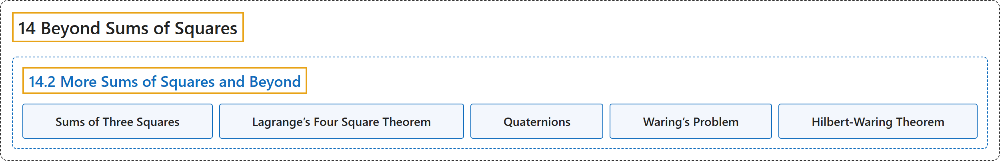

# 14.2 More Sums of Squares and Beyond

## Classification

## Glossary

| Term | Definition | 中文翻译 | Source |
|---|---|---|---|
| **14.2 More Sums of Squares and Beyond** 更多平方和及其推广 | (No definition) | （无定义） | [Crisman, 2024, section 14.2](https://math.gordon.edu/ntic/ntic/section-more-sums.html) |
| **Sums of Three Squares** 三平方和 | "A positive integer may be written as a sum of *three* squares if and only if **it does *not* have the form of a product of an *even* power of two times an *odd* number which is congruent to seven modulo eight**." | 一个正整数能写成*三个*平方数之和，当且仅当**它*不*具有“二的*偶*数次幂乘以一个模八余七的*奇*数”这种形式**。 | [Crisman, 2024, Fact 14.2.1](https://math.gordon.edu/ntic/ntic/section-more-sums.html#fact-three-squares) |
| **Lagrange’s Four Square Theorem** 拉格朗日四平方定理 | "**Any nonnegative integer may be written as a sum of four squares.**" | **任何非负整数都能写成四个平方数之和**。 | [Crisman, 2024, Fact 14.2.2](https://math.gordon.edu/ntic/ntic/section-more-sums.html#fact-lagrange-four-square) |
| **Quaternions** 四元数 | "Both types of proof are interesting, because on the one hand an algebraic proof can use **the extension of the complex numbers** called the **quaternions**" | 两类证明都很有意思，因为一方面，代数证明可以用到称为**四元数**的**复数的扩充** | [Crisman, 2024, Fact 14.2.2](https://math.gordon.edu/ntic/ntic/section-more-sums.html#fact-lagrange-four-square) |
| **Waring’s Problem** 华林问题 | "The English mathematician Edward Waring asked for **an outrageous generalization of these questions of sums of powers**, which is still an active area of research called **Waring’s Problem**." | 英国数学家爱德华华林提出了**这些幂和问题的一个大胆推广**，至今仍是活跃的研究领域，称为**华林问题**。 | [Crisman, 2024, subsection 14.2.3](https://math.gordon.edu/ntic/ntic/section-more-sums.html#subsection-waring-2) |
| **Hilbert-Waring Theorem** 希尔伯特-华林定理 | "For each positive integer power $m$, there is a number $g(m)$ such that ***every* nonnegative integer can be written as a sum of $g(m)$ $m$th powers**." | 对每个正整数次幂 $m$，存在一个数 $g(m)$，使得***每个*非负整数都能写成 $g(m)$ 个 $m$ 次幂之和**。 | [Crisman, 2024, Fact 14.2.8](https://math.gordon.edu/ntic/ntic/section-more-sums.html#fact-hilbert-waring) |

## References

Crisman, K.-D. (2024). *Number theory: In context and interactive* (June 26, 2024 edition). Gordon College. Retrieved October 29, 2026, from <https://math.gordon.edu/ntic/ntic/>
