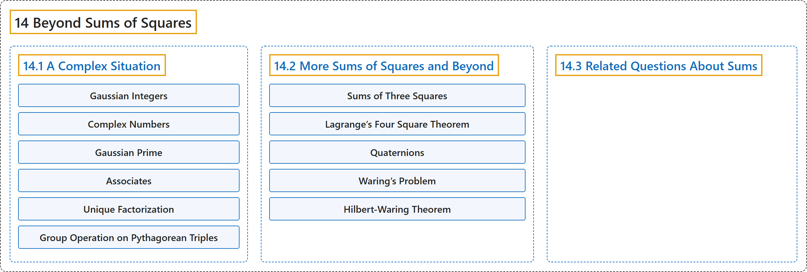

# 14 Beyond Sums of Squares

## Classification

## Glossary

| Term | Definition | 中文翻译 | Source |
|---|---|---|---|
| **14 Beyond Sums of Squares** 平方和之外 | (No definition) | （无定义） | [Crisman, 2024, chapter 14](https://math.gordon.edu/ntic/ntic/chapter-beyond-squares.html) |
| **[14.1 A Complex Situation](14-1-a-complex-situation.md)** 复数情形 | (No definition) | （无定义） | [Crisman, 2024, section 14.1](https://math.gordon.edu/ntic/ntic/section-complex-sums.html) |
| **[14.2 More Sums of Squares and Beyond](14-2-more-sums-of-squares-and-beyond.md)** 更多平方和及其推广 | (No definition) | （无定义） | [Crisman, 2024, section 14.2](https://math.gordon.edu/ntic/ntic/section-more-sums.html) |
| **[14.3 Related Questions About Sums](14-3-related-questions-about-sums.md)** 关于和的相关问题 | (No definition) | （无定义） | [Crisman, 2024, section 14.3](https://math.gordon.edu/ntic/ntic/section-related-sums.html) |

## References

Crisman, K.-D. (2024). *Number theory: In context and interactive* (June 26, 2024 edition). Gordon College. Retrieved October 29, 2026, from <https://math.gordon.edu/ntic/ntic/>
