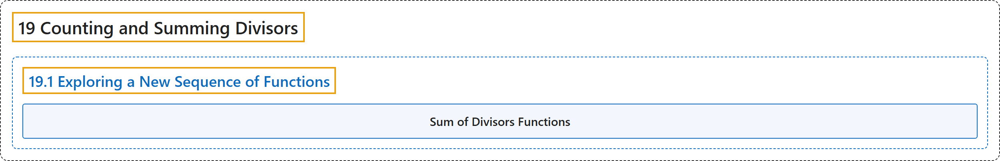

# 19.1 Exploring a New Sequence of Functions

## Classification

## Glossary

| Term | Definition | 中文翻译 | Source |
|---|---|---|---|
| **19.1 Exploring a New Sequence of Functions** 探索一列新函数 | (No definition) | （无定义） | [Crisman, 2024, section 19.1](https://math.gordon.edu/ntic/ntic/section-new-function-expl.html) |
| **Sum of Divisors Functions** 因数和函数 | "For $n>0$, let $\sigma_k(n)$ be defined as **the sum of the $k$th power of the (positive) divisors of $n$**, thus: $\sigma_k(n)=\sum_{d\mid n}d^k$." | 对 $n>0$，令 $\sigma_k(n)$ 定义为 **$n$ 的（正）因数的 $k$ 次幂之和**，即 $\sigma_k(n)=\sum_{d\mid n}d^k$。 | [Crisman, 2024, Definition 19.1.1](https://math.gordon.edu/ntic/ntic/section-new-function-expl.html#definition-sigma) |

## References

Crisman, K.-D. (2024). *Number theory: In context and interactive* (June 26, 2024 edition). Gordon College. Retrieved October 29, 2026, from <https://math.gordon.edu/ntic/ntic/>
