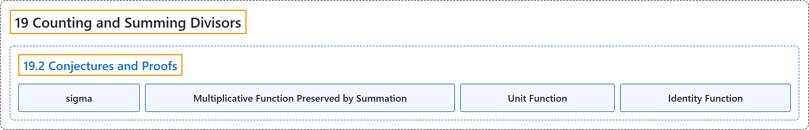

# 19.2 Conjectures and Proofs

## Classification

## Glossary

| Term | Definition | 中文翻译 | Source |
|---|---|---|---|
| **19.2 Conjectures and Proofs** 猜想与证明 | (No definition) | （无定义） | [Crisman, 2024, section 19.2](https://math.gordon.edu/ntic/ntic/section-new-func-conjectures.html) |
| **sigma** sigma | "Here is **the syntax for doing this in Sage**. However, for this function it is better to try it out by hand first!" | 下面是**在 Sage 中做这件事的语法**。不过对这个函数，最好先手算试试！ | [Crisman, 2024, Sage note 19.2.2](https://math.gordon.edu/ntic/ntic/section-new-func-conjectures.html#sagenote-sigma-syntax) |
| **Multiplicative Function Preserved by Summation** 积性函数在求和下保持 | "If $g$ is multiplicative and $f(n)$ is defined as $f(n)=\sum_{d\mid n}g(d)$ then **$f$ is also multiplicative**." | 若 $g$ 是积性的，且 $f(n)$ 定义为 $f(n)=\sum_{d\mid n}g(d)$，则 **$f$ 也是积性的**。 | [Crisman, 2024, Theorem 19.2.7](https://math.gordon.edu/ntic/ntic/section-new-func-conjectures.html#theorem-multiplicative-multiplies) |
| **Unit Function** 单位函数 | "Let us set the following two arithmetic functions: **$u(n)=1$** is the ***unit* function** **$N(n)=n$** is the ***identity* function**" | 我们设定下面两个算术函数：**$u(n)=1$** 是***单位*函数**；**$N(n)=n$** 是***恒等*函数** | [Crisman, 2024, Definition 19.2.9](https://math.gordon.edu/ntic/ntic/section-new-func-conjectures.html#definition-unit-identity-functions) |
| **Identity Function** 恒等函数 | "Let us set the following two arithmetic functions: **$u(n)=1$** is the ***unit* function** **$N(n)=n$** is the ***identity* function**" | 我们设定下面两个算术函数：**$u(n)=1$** 是***单位*函数**；**$N(n)=n$** 是***恒等*函数** | [Crisman, 2024, Definition 19.2.9](https://math.gordon.edu/ntic/ntic/section-new-func-conjectures.html#definition-unit-identity-functions) |

## References

Crisman, K.-D. (2024). *Number theory: In context and interactive* (June 26, 2024 edition). Gordon College. Retrieved October 29, 2026, from <https://math.gordon.edu/ntic/ntic/>
