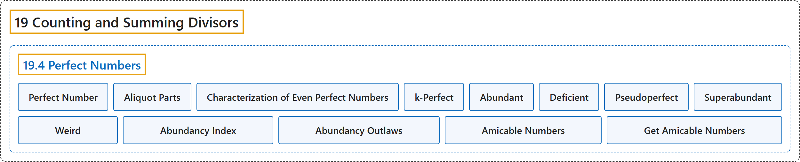

# 19.4 Perfect Numbers

## Classification

## Glossary

| Term | Definition | 中文翻译 | Source |
|---|---|---|---|
| **19.4 Perfect Numbers** 完全数 | (No definition) | （无定义） | [Crisman, 2024, section 19.4](https://math.gordon.edu/ntic/ntic/section-perfect-nums.html) |
| **Perfect Number** 完全数 | "When **the ratio $\frac{\sigma(n)}{n}$ is exactly $2$**, we say $n$ is a **perfect number**." | 当**比值 $\frac{\sigma(n)}{n}$ 恰好为 $2$** 时，就说 $n$ 是**完全数**。 | [Crisman, 2024, Definition 19.4.1](https://math.gordon.edu/ntic/ntic/section-perfect-nums.html#definition-perfect) |
| **Aliquot Parts** 真因数（aliquot parts） | "It is easy to see this is the same thing as $n$ being **the sum of all of its proper divisors**" | 容易看出，这等同于 $n$ 是**它所有真因数之和** | [Crisman, 2024, subsection 19.4.1](https://math.gordon.edu/ntic/ntic/section-perfect-nums.html#subsection-perfect-nums-3) |
| **Characterization of Even Perfect Numbers** 偶完全数的刻画 | "If $N$ is an even number, it is perfect if and only if **it is the product of a power $2^{n-1}$ and a prime of the form $2^n-1$** (for the same $n$)." | 若 $N$ 是偶数，则它是完全数，当且仅当**它是一个幂 $2^{n-1}$ 与一个形如 $2^n-1$ 的素数之积**（$n$ 相同）。 | [Crisman, 2024, Theorem 19.4.3](https://math.gordon.edu/ntic/ntic/section-perfect-nums.html#theorem-even-perfect) |
| **k-Perfect** k-完全数 | "Recall that if $\sigma(n)=2n$, then $n$ is perfect. If **$\sigma(n)=kn$ for some integer $k$**, then we say that $n$ is **$k$-perfect**. Or, if **$\sigma(n)>2n$**, then $n$ is **abundant.** If **$\sigma(n)<2n$**, we say $n$ is **deficient**." | 回忆一下，若 $\sigma(n)=2n$，则 $n$ 是完全数。若**对某个整数 $k$ 有 $\sigma(n)=kn$**，就说 $n$ 是 **$k$-完全数**。或者，若 **$\sigma(n)>2n$**，则 $n$ 是**过剩数**。若 **$\sigma(n)<2n$**，就说 $n$ 是**亏数**。 | [Crisman, 2024, Definition 19.4.4](https://math.gordon.edu/ntic/ntic/section-perfect-nums.html#definition-k-perfect) |
| **Abundant** 过剩数 | "Recall that if $\sigma(n)=2n$, then $n$ is perfect. If **$\sigma(n)=kn$ for some integer $k$**, then we say that $n$ is **$k$-perfect**. Or, if **$\sigma(n)>2n$**, then $n$ is **abundant.** If **$\sigma(n)<2n$**, we say $n$ is **deficient**." | 回忆一下，若 $\sigma(n)=2n$，则 $n$ 是完全数。若**对某个整数 $k$ 有 $\sigma(n)=kn$**，就说 $n$ 是 **$k$-完全数**。或者，若 **$\sigma(n)>2n$**，则 $n$ 是**过剩数**。若 **$\sigma(n)<2n$**，就说 $n$ 是**亏数**。 | [Crisman, 2024, Definition 19.4.4](https://math.gordon.edu/ntic/ntic/section-perfect-nums.html#definition-k-perfect) |
| **Deficient** 亏数 | "Recall that if $\sigma(n)=2n$, then $n$ is perfect. If **$\sigma(n)=kn$ for some integer $k$**, then we say that $n$ is **$k$-perfect**. Or, if **$\sigma(n)>2n$**, then $n$ is **abundant.** If **$\sigma(n)<2n$**, we say $n$ is **deficient**." | 回忆一下，若 $\sigma(n)=2n$，则 $n$ 是完全数。若**对某个整数 $k$ 有 $\sigma(n)=kn$**，就说 $n$ 是 **$k$-完全数**。或者，若 **$\sigma(n)>2n$**，则 $n$ 是**过剩数**。若 **$\sigma(n)<2n$**，就说 $n$ 是**亏数**。 | [Crisman, 2024, Definition 19.4.4](https://math.gordon.edu/ntic/ntic/section-perfect-nums.html#definition-k-perfect) |
| **Pseudoperfect** 半完全数 | "Here are some less well-known, but nonetheless interesting, terms. A number is **pseudoperfect** if **it is the sum of *some* of its divisors (other than itself)**. A number $n$ is **superabundant** if **the ratio $\sigma(n)/n$ for $n$ is bigger than the value of the ratio for all smaller $m\lt n$**. A number is **weird** if **it is abundant but not pseudoperfect**." | 下面是一些不太为人所知但仍有意思的术语。若一个数**是它的*某些*因数（不含它自身）之和**，就称为**半完全数**。若 **$n$ 的比值 $\sigma(n)/n$ 大于所有更小的 $m\lt n$ 的比值**，就称 $n$ 为**高过剩数**。若一个数**是过剩数但不是半完全数**，就称为**奇异数**。 | [Crisman, 2024, Definition 19.4.5](https://math.gordon.edu/ntic/ntic/section-perfect-nums.html#definition-weird) |
| **Superabundant** 高过剩数 | "Here are some less well-known, but nonetheless interesting, terms. A number is **pseudoperfect** if **it is the sum of *some* of its divisors (other than itself)**. A number $n$ is **superabundant** if **the ratio $\sigma(n)/n$ for $n$ is bigger than the value of the ratio for all smaller $m\lt n$**. A number is **weird** if **it is abundant but not pseudoperfect**." | 下面是一些不太为人所知但仍有意思的术语。若一个数**是它的*某些*因数（不含它自身）之和**，就称为**半完全数**。若 **$n$ 的比值 $\sigma(n)/n$ 大于所有更小的 $m\lt n$ 的比值**，就称 $n$ 为**高过剩数**。若一个数**是过剩数但不是半完全数**，就称为**奇异数**。 | [Crisman, 2024, Definition 19.4.5](https://math.gordon.edu/ntic/ntic/section-perfect-nums.html#definition-weird) |
| **Weird** 奇异数 | "Here are some less well-known, but nonetheless interesting, terms. A number is **pseudoperfect** if **it is the sum of *some* of its divisors (other than itself)**. A number $n$ is **superabundant** if **the ratio $\sigma(n)/n$ for $n$ is bigger than the value of the ratio for all smaller $m\lt n$**. A number is **weird** if **it is abundant but not pseudoperfect**." | 下面是一些不太为人所知但仍有意思的术语。若一个数**是它的*某些*因数（不含它自身）之和**，就称为**半完全数**。若 **$n$ 的比值 $\sigma(n)/n$ 大于所有更小的 $m\lt n$ 的比值**，就称 $n$ 为**高过剩数**。若一个数**是过剩数但不是半完全数**，就称为**奇异数**。 | [Crisman, 2024, Definition 19.4.5](https://math.gordon.edu/ntic/ntic/section-perfect-nums.html#definition-weird) |
| **Abundancy Index** 丰度指数 | "The ratio **$\frac{\sigma(n)}{n}$** may be called the **abundancy index** of $n$." | 比值 **$\frac{\sigma(n)}{n}$** 可以称为 $n$ 的**丰度指数**。 | [Crisman, 2024, Definition 19.4.7](https://math.gordon.edu/ntic/ntic/section-perfect-nums.html#definition-abundancy-index) |
| **Abundancy Outlaws** 丰度不法数 | "Holdener and Stanton picturesquely call **rational numbers which are not abundancies** **abundancy outlaws**." | Holdener 和 Stanton 形象地把**不是丰度指数的有理数**称为**丰度不法数**。 | [Crisman, 2024, subsection 19.4.3](https://math.gordon.edu/ntic/ntic/section-perfect-nums.html#subsection-abundancy-10) |
| **Amicable Numbers** 亲和数 | "A pair of positive integers $m,n$ such that **$\sigma(n)=\sigma(m)=m+n$** is called a pair of **amicable** numbers." | 满足 **$\sigma(n)=\sigma(m)=m+n$** 的一对正整数 $m,n$ 称为一对**亲和**数。 | [Crisman, 2024, Definition 19.4.11](https://math.gordon.edu/ntic/ntic/section-perfect-nums.html#definition-amicable) |
| **Get Amicable Numbers** 求亲和数 | "Here is one way to get amicable numbers. Make a list of numbers of the form $p_n=3\cdot 2^n-1$ and $q_n=9\cdot 2^{2n-1}-1$. Then check if $p_{n-1}$, $p_n$, and $q_n$ are all prime. If so, then **$2^np_{n-1}p_n$ and $2^nq_n$ are an amicable pair**." | 下面是得到亲和数的一种方法。列出形如 $p_n=3\cdot 2^n-1$ 和 $q_n=9\cdot 2^{2n-1}-1$ 的数。然后检验 $p_{n-1}$、$p_n$ 和 $q_n$ 是否都是素数。若是，则 **$2^np_{n-1}p_n$ 与 $2^nq_n$ 是一对亲和数**。 | [Crisman, 2024, Algorithm 19.4.14](https://math.gordon.edu/ntic/ntic/section-perfect-nums.html#algorithm-amicable) |

## References

Crisman, K.-D. (2024). *Number theory: In context and interactive* (June 26, 2024 edition). Gordon College. Retrieved October 29, 2026, from <https://math.gordon.edu/ntic/ntic/>
