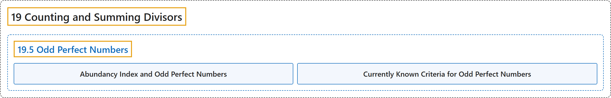

# 19.5 Odd Perfect Numbers

## Classification

## Glossary

| Term | Definition | 中文翻译 | Source |
|---|---|---|---|
| **19.5 Odd Perfect Numbers** 奇完全数 | "**Does there exist an odd perfect number?**" | **是否存在奇完全数？** | [Crisman, 2024, Question 19.5.1](https://math.gordon.edu/ntic/ntic/section-oddly-perfect.html#question-odd-perfect) |
| **Abundancy Index and Odd Perfect Numbers** 丰度指数与奇完全数 | "If **$\frac{5}{3}$ is the abundancy index of $N$**, then **$5N$ is an odd perfect number**." | 若 **$\frac{5}{3}$ 是 $N$ 的丰度指数**，则 **$5N$ 是奇完全数**。 | [Crisman, 2024, Theorem 19.5.4](https://math.gordon.edu/ntic/ntic/section-oddly-perfect.html#theorem-odd-perfect-abundancy-5-3) |
| **Currently Known Criteria for Odd Perfect Numbers** 奇完全数的现有判据 | "An odd perfect number must (as of 2021): **Be greater than $10^{1500}$**." | 奇完全数必须（截至 2021 年）：**大于 $10^{1500}$**。 | [Crisman, 2024, Fact 19.5.5](https://math.gordon.edu/ntic/ntic/section-oddly-perfect.html#fact-odd-perfect) |

## References

Crisman, K.-D. (2024). *Number theory: In context and interactive* (June 26, 2024 edition). Gordon College. Retrieved October 29, 2026, from <https://math.gordon.edu/ntic/ntic/>
