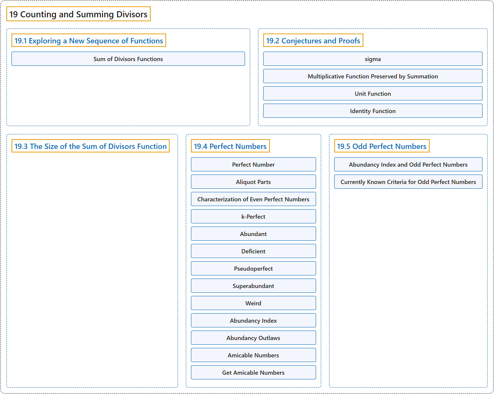

# 19 Counting and Summing Divisors

## Classification

## Glossary

| Term | Definition | 中文翻译 | Source |
|---|---|---|---|
| **19 Counting and Summing Divisors** 因数的计数与求和 | (No definition) | （无定义） | [Crisman, 2024, chapter 19](https://math.gordon.edu/ntic/ntic/chapter-sums-divisors.html) |
| **[19.1 Exploring a New Sequence of Functions](19-1-exploring-a-new-sequence-of-functions.md)** 探索一列新函数 | (No definition) | （无定义） | [Crisman, 2024, section 19.1](https://math.gordon.edu/ntic/ntic/section-new-function-expl.html) |
| **[19.2 Conjectures and Proofs](19-2-conjectures-and-proofs.md)** 猜想与证明 | (No definition) | （无定义） | [Crisman, 2024, section 19.2](https://math.gordon.edu/ntic/ntic/section-new-func-conjectures.html) |
| **[19.3 The Size of the Sum of Divisors Function](19-3-the-size-of-the-sum-of-divisors-function.md)** 因数和函数的大小 | (No definition) | （无定义） | [Crisman, 2024, section 19.3](https://math.gordon.edu/ntic/ntic/section-sum-divisors.html) |
| **[19.4 Perfect Numbers](19-4-perfect-numbers.md)** 完全数 | (No definition) | （无定义） | [Crisman, 2024, section 19.4](https://math.gordon.edu/ntic/ntic/section-perfect-nums.html) |
| **[19.5 Odd Perfect Numbers](19-5-odd-perfect-numbers.md)** 奇完全数 | (No definition) | （无定义） | [Crisman, 2024, section 19.5](https://math.gordon.edu/ntic/ntic/section-oddly-perfect.html) |

## References

Crisman, K.-D. (2024). *Number theory: In context and interactive* (June 26, 2024 edition). Gordon College. Retrieved October 29, 2026, from <https://math.gordon.edu/ntic/ntic/>
