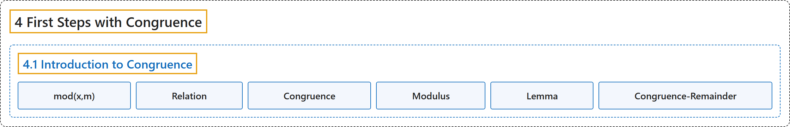

# 4.1 Introduction to Congruence

## Classification

## Glossary

| Term | Definition | 中文翻译 | Source |
|---|---|---|---|
| **4.1 Introduction to Congruence** 同余简介 | (No definition) | （无定义） | [Crisman, 2024, section 4.1](https://math.gordon.edu/ntic/ntic/section-intro-congruence.html) |
| **mod(x,m)** mod(x,m) | "In general, the command `x % m` computes “$x$ modulo $m$”, which is to say **the remainder of $x$ when you divide by $m$**. An alternate way to do this is with the command **`mod(x,m)`**." | 一般地，命令 `x % m` 计算“$x$ 模 $m$”，即 **$x$ 除以 $m$ 的余数**。另一种做法是用命令 **`mod(x,m)`**。 | [Crisman, 2024, section 4.1](https://math.gordon.edu/ntic/ntic/section-intro-congruence.html#section-intro-congruence-5) |
| **Relation** 关系 | "In mathematics, what we often do in such a situation where structure is shared is **connect things** with a **relation**." | 在数学中，遇到这种结构相同的情形，我们常做的是用一个**关系**把**事物联系起来**。 | [Crisman, 2024, section 4.1](https://math.gordon.edu/ntic/ntic/section-intro-congruence.html#section-intro-congruence-11) |
| **Congruence** 同余 | "We say that a number $a$ **is congruent to** $b$ (another number) **modulo $n$**, or $a \equiv b \text{ (mod }n)$, **precisely if $n\mid (a-b)$**. We call $n$, normally a positive integer greater than one, the modulus. The noun form of the relationship is called **congruence**." | 若**恰好 $n\mid (a-b)$**，就说数 $a$ **模 $n$ 同余于** $b$（另一个数），记作 $a \equiv b \text{ (mod }n)$。我们把 $n$（通常是大于一的正整数）称为模。这一关系的名词形式称为**同余**。 | [Crisman, 2024, Definition 4.1.1](https://math.gordon.edu/ntic/ntic/section-intro-congruence.html#definition-congruence) |
| **Modulus** 模 | "We say that a number $a$ is congruent to $b$ (another number) modulo $n$, or $a \equiv b \text{ (mod }n)$, precisely if $n\mid (a-b)$. We call **$n$, normally a positive integer greater than one**, the **modulus**." | 若 $n\mid (a-b)$，就说数 $a$ 模 $n$ 同余于 $b$（另一个数），记作 $a \equiv b \text{ (mod }n)$。我们把 **$n$**（**通常是大于一的正整数**）称为**模**。 | [Crisman, 2024, Definition 4.1.1](https://math.gordon.edu/ntic/ntic/section-intro-congruence.html#definition-congruence) |
| **Lemma** 引理 | "Often we can prove **a small helping statement**, usually called a **lemma**." | 我们常常可以证明一个**小的辅助命题**，通常称为**引理**。 | [Crisman, 2024, section 4.1](https://math.gordon.edu/ntic/ntic/section-intro-congruence.html#section-intro-congruence-14) |
| **Congruence-Remainder** 同余与余数 | "Saying $a \equiv b\text{ (mod }n)$ is **exactly the same thing as saying $a$ and $b$ leave the same remainder when divided by $n$**." | 说 $a \equiv b\text{ (mod }n)$，**与说 $a$ 和 $b$ 除以 $n$ 余数相同完全是一回事**。 | [Crisman, 2024, Lemma 4.1.2](https://math.gordon.edu/ntic/ntic/section-intro-congruence.html#lemma-congruence-remainder) |

## References

Crisman, K.-D. (2024). *Number theory: In context and interactive* (June 26, 2024 edition). Gordon College. Retrieved October 29, 2026, from <https://math.gordon.edu/ntic/ntic/>
