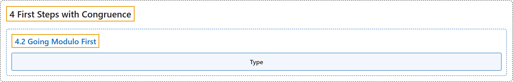

# 4.2 Going Modulo First

## Classification

## Glossary

| Term | Definition | 中文翻译 | Source |
|---|---|---|---|
| **4.2 Going Modulo First** 先取模 | (No definition) | （无定义） | [Crisman, 2024, section 4.2](https://math.gordon.edu/ntic/ntic/section-modulo-first.html) |
| **Type** 类型 | "In Python, we can ask for the `type` of anything.In this case, we asked to output `b` and then its type, which is **definitely not an ordinary integer, and can be manipulated much more efficiently**." | 在 Python 中，任何东西都可以查询它的 `type`（类型）。这里我们让它输出 `b` 及其类型，它**显然不是普通整数，可以被高效得多地处理**。 | [Crisman, 2024, Sage note 4.2.6](https://math.gordon.edu/ntic/ntic/section-modulo-first.html#sagenote-types-matter) |

## References

Crisman, K.-D. (2024). *Number theory: In context and interactive* (June 26, 2024 edition). Gordon College. Retrieved October 29, 2026, from <https://math.gordon.edu/ntic/ntic/>
