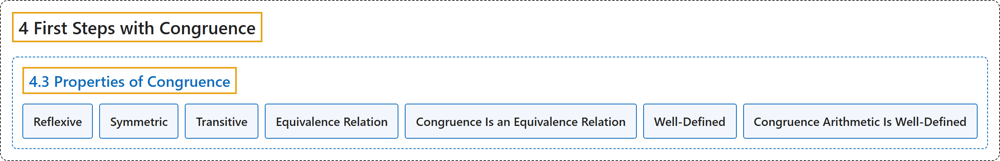

# 4.3 Properties of Congruence

## Classification

## Glossary

| Term | Definition | 中文翻译 | Source |
|---|---|---|---|
| **4.3 Properties of Congruence** 同余的性质 | (No definition) | （无定义） | [Crisman, 2024, section 4.3](https://math.gordon.edu/ntic/ntic/section-cong-props.html) |
| **Reflexive** 自反的 | "Congruence is **reflexive**, symmetric, and transitive, which are the conditions for it to be an equivalence relation. **For any $a\in \mathbb{Z}$, $a\equiv a$ (mod $n$).** If $a\equiv b$ (mod $n$), then $b\equiv a$ (mod $n$). If it happens that *both* $a\equiv b$ and $b\equiv c$ (mod $n$), then $a\equiv c$ (mod $n$) as well." | 同余是**自反的**、对称的、传递的，这正是它成为等价关系的条件。**对任意 $a\in \mathbb{Z}$，$a\equiv a$（mod $n$）**。若 $a\equiv b$（mod $n$），则 $b\equiv a$（mod $n$）。若*同时*有 $a\equiv b$ 与 $b\equiv c$（mod $n$），则也有 $a\equiv c$（mod $n$）。 | [Crisman, 2024, Proposition 4.3.1](https://math.gordon.edu/ntic/ntic/section-cong-props.html#prop-congruence-eq-rel) |
| **Symmetric** 对称的 | "Congruence is reflexive, **symmetric**, and transitive, which are the conditions for it to be an equivalence relation. For any $a\in \mathbb{Z}$, $a\equiv a$ (mod $n$). **If $a\equiv b$ (mod $n$), then $b\equiv a$ (mod $n$).** If it happens that *both* $a\equiv b$ and $b\equiv c$ (mod $n$), then $a\equiv c$ (mod $n$) as well." | 同余是自反的、**对称的**、传递的，这正是它成为等价关系的条件。对任意 $a\in \mathbb{Z}$，$a\equiv a$（mod $n$）。**若 $a\equiv b$（mod $n$），则 $b\equiv a$（mod $n$）**。若*同时*有 $a\equiv b$ 与 $b\equiv c$（mod $n$），则也有 $a\equiv c$（mod $n$）。 | [Crisman, 2024, Proposition 4.3.1](https://math.gordon.edu/ntic/ntic/section-cong-props.html#prop-congruence-eq-rel) |
| **Transitive** 传递的 | "Congruence is reflexive, symmetric, and **transitive**, which are the conditions for it to be an equivalence relation. For any $a\in \mathbb{Z}$, $a\equiv a$ (mod $n$). If $a\equiv b$ (mod $n$), then $b\equiv a$ (mod $n$). **If it happens that *both* $a\equiv b$ and $b\equiv c$ (mod $n$), then $a\equiv c$ (mod $n$) as well.**" | 同余是自反的、对称的、**传递的**，这正是它成为等价关系的条件。对任意 $a\in \mathbb{Z}$，$a\equiv a$（mod $n$）。若 $a\equiv b$（mod $n$），则 $b\equiv a$（mod $n$）。**若*同时*有 $a\equiv b$ 与 $b\equiv c$（mod $n$），则也有 $a\equiv c$（mod $n$）**。 | [Crisman, 2024, Proposition 4.3.1](https://math.gordon.edu/ntic/ntic/section-cong-props.html#prop-congruence-eq-rel) |
| **Equivalence Relation** 等价关系 | "Congruence is **reflexive**, **symmetric**, and **transitive**, which are **the conditions for it to be an equivalence relation**." | 同余是**自反的**、**对称的**、**传递的**，这些正是**它成为等价关系的条件**。 | [Crisman, 2024, Proposition 4.3.1](https://math.gordon.edu/ntic/ntic/section-cong-props.html#prop-congruence-eq-rel) |
| **Congruence Is an Equivalence Relation** 同余是等价关系 | "Congruence is reflexive, symmetric, and transitive, which are the conditions for it to be an equivalence relation. For any $a\in \mathbb{Z}$, $a\equiv a$ (mod $n$). If $a\equiv b$ (mod $n$), then $b\equiv a$ (mod $n$). If it happens that *both* $a\equiv b$ and $b\equiv c$ (mod $n$), then $a\equiv c$ (mod $n$) as well." | 同余是自反的、对称的、传递的，这正是它成为等价关系的条件。对任意 $a\in \mathbb{Z}$，$a\equiv a$（mod $n$）。若 $a\equiv b$（mod $n$），则 $b\equiv a$（mod $n$）。若*同时*有 $a\equiv b$ 与 $b\equiv c$（mod $n$），则也有 $a\equiv c$（mod $n$）。 | [Crisman, 2024, Proposition 4.3.1](https://math.gordon.edu/ntic/ntic/section-cong-props.html#prop-congruence-eq-rel) |
| **Well-Defined** 良定义 | "Addition and multiplication modulo $n$ are **well-defined**. That is, **if $a\equiv c$ and $b\equiv d$ (modulo some fixed modulus $n$), then both of these congruences hold**: $a+b\equiv c+d$ $ab\equiv cd$" | 模 $n$ 的加法和乘法是**良定义的**。也就是说，**若 $a\equiv c$ 且 $b\equiv d$（对某个固定的模 $n$），则下面两个同余式都成立**：$a+b\equiv c+d$，$ab\equiv cd$。 | [Crisman, 2024, Proposition 4.3.2](https://math.gordon.edu/ntic/ntic/section-cong-props.html#prop-congruence-well-def) |
| **Congruence Arithmetic Is Well-Defined** 同余运算是良定义的 | "Addition and multiplication modulo $n$ are well-defined. That is, if $a\equiv c$ and $b\equiv d$ (modulo some fixed modulus $n$), then both of these congruences hold: $a+b\equiv c+d$ $ab\equiv cd$" | 模 $n$ 的加法和乘法是良定义的。也就是说，若 $a\equiv c$ 且 $b\equiv d$（对某个固定的模 $n$），则下面两个同余式都成立：$a+b\equiv c+d$，$ab\equiv cd$。 | [Crisman, 2024, Proposition 4.3.2](https://math.gordon.edu/ntic/ntic/section-cong-props.html#prop-congruence-well-def) |

## References

Crisman, K.-D. (2024). *Number theory: In context and interactive* (June 26, 2024 edition). Gordon College. Retrieved October 29, 2026, from <https://math.gordon.edu/ntic/ntic/>
