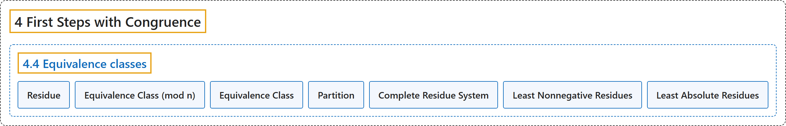

# 4.4 Equivalence classes

## Classification

## Glossary

| Term | Definition | 中文翻译 | Source |
|---|---|---|---|
| **4.4 Equivalence classes** 等价类 | (No definition) | （无定义） | [Crisman, 2024, section 4.4](https://math.gordon.edu/ntic/ntic/section-equiv-classes.html) |
| **Residue** 剩余 | "Assume throughout that we have fixed a modulus $n$. We call ***any* number congruent to $a$** a **residue** of $a$." | 始终假设已固定模 $n$。我们把**与 $a$ 同余的*任何*数**称为 $a$ 的一个**剩余**。 | [Crisman, 2024, Definition 4.4.1](https://math.gordon.edu/ntic/ntic/section-equiv-classes.html#definition-equiv-class-mod-n) |
| **Equivalence Class (mod n)** （模 n 的）等价类 | "Assume throughout that we have fixed a modulus $n$. We call *any* number congruent to $a$ a residue of $a$. We call **the collection of *all* residues of $a$** the **equivalence class** of $a$." | 始终假设已固定模 $n$。我们把与 $a$ 同余的*任何*数称为 $a$ 的一个剩余。我们把 **$a$ 的*全部*剩余组成的集合**称为 $a$ 的**等价类**。 | [Crisman, 2024, Definition 4.4.1](https://math.gordon.edu/ntic/ntic/section-equiv-classes.html#definition-equiv-class-mod-n) |
| **Equivalence Class** 等价类 | "*Any* set (not just $\mathbb{Z}$) that has an equivalence relation on it can be broken up into **disjoint subsets** called **equivalence classes**." | *任何*带有等价关系的集合（不只是 $\mathbb{Z}$）都可以分解成称为**等价类**的**互不相交的子集**。 | [Crisman, 2024, Fact 4.4.3](https://math.gordon.edu/ntic/ntic/section-equiv-classes.html#fact-equiv-classes) |
| **Partition** 划分 | "*Any* set (not just $\mathbb{Z}$) that has an equivalence relation on it can be broken up into disjoint subsets called equivalence classes. It can be useful to consider these classes as elements of a set of all such classes. Such **a set of subsets** is called a **partition**." | *任何*带有等价关系的集合（不只是 $\mathbb{Z}$）都可以分解成称为等价类的互不相交的子集。把这些类看作由所有这样的类组成的集合的元素，会很有用。这样的**子集的集合**称为**划分**。 | [Crisman, 2024, Fact 4.4.3](https://math.gordon.edu/ntic/ntic/section-equiv-classes.html#fact-equiv-classes) |
| **Complete Residue System** 完全剩余系 | "We call **a set of integers with precisely one for each equivalence class** a **complete residue system** or **complete set of residues** for a given modulus." | 对给定的模，**恰好在每个等价类中各取一个整数所成的集合**，称为**完全剩余系**或**完全剩余集**。 | [Crisman, 2024, Definition 4.4.6](https://math.gordon.edu/ntic/ntic/section-equiv-classes.html#definition-residue-system) |
| **Least Nonnegative Residues** 最小非负剩余 | "We call a set of integers with precisely one for each equivalence class a complete residue system or complete set of residues for a given modulus. Usually, we just use **the ‘normal’ remainders**; this is called the set of **least nonnegative residues**." | 对给定的模，恰好在每个等价类中各取一个整数所成的集合，称为完全剩余系或完全剩余集。通常我们就用 **“普通”的余数**；这称为**最小非负剩余**的集合。 | [Crisman, 2024, Definition 4.4.6](https://math.gordon.edu/ntic/ntic/section-equiv-classes.html#definition-residue-system) |
| **Least Absolute Residues** 绝对最小剩余 | "We call a set of integers with precisely one for each equivalence class a complete residue system or complete set of residues for a given modulus. Usually, we just use the ‘normal’ remainders; this is called the set of least nonnegative residues. Sometimes we use the set of **least absolute residues**, **the collection of representatives of each class which are closest to zero**." | 对给定的模，恰好在每个等价类中各取一个整数所成的集合，称为完全剩余系或完全剩余集。通常我们就用“普通”的余数；这称为最小非负剩余的集合。有时我们用**绝对最小剩余**的集合，即**每个类中最接近零的代表所成的集合**。 | [Crisman, 2024, Definition 4.4.6](https://math.gordon.edu/ntic/ntic/section-equiv-classes.html#definition-residue-system) |

## References

Crisman, K.-D. (2024). *Number theory: In context and interactive* (June 26, 2024 edition). Gordon College. Retrieved October 29, 2026, from <https://math.gordon.edu/ntic/ntic/>
