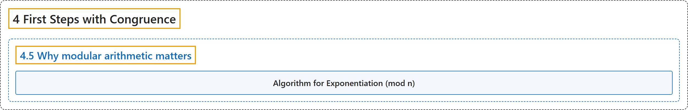

# 4.5 Why modular arithmetic matters

## Classification

## Glossary

| Term | Definition | 中文翻译 | Source |
|---|---|---|---|
| **4.5 Why modular arithmetic matters** 模运算为何重要 | (No definition) | （无定义） | [Crisman, 2024, section 4.5](https://math.gordon.edu/ntic/ntic/section-why-mod-matters.html) |
| **Algorithm for Exponentiation (mod n)** 模 n 求幂的算法 | "In general, we can compute $x^k$ modulo $n$: **Write the exponent $k=\sum_{i=1}^{\ell} k_i 2^i$, where each $k_i=0$ or $1$.** (This is called the binary representation of $k$.) **Compute $x^2$, $x^4$, $x^8$, and so forth as above, each time reducing modulo $n$.** **Multiply $\prod_{i=1}^{\ell} x^{k_i 2^i}$ together as in the examples above.**" | 一般地，我们可以这样计算 $x^k$ 模 $n$：**把指数写成 $k=\sum_{i=1}^{\ell} k_i 2^i$，其中每个 $k_i=0$ 或 $1$。**（这称为 $k$ 的二进制表示。）**像上面那样计算 $x^2$、$x^4$、$x^8$ 等等，每次都模 $n$ 约化。** **像上面的例子那样把 $\prod_{i=1}^{\ell} x^{k_i 2^i}$ 乘起来。** | [Crisman, 2024, Algorithm 4.5.8](https://math.gordon.edu/ntic/ntic/section-why-mod-matters.html#algorithm-powers-modulo) |

## References

Crisman, K.-D. (2024). *Number theory: In context and interactive* (June 26, 2024 edition). Gordon College. Retrieved October 29, 2026, from <https://math.gordon.edu/ntic/ntic/>
