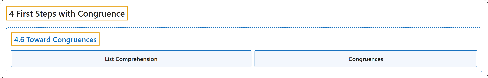

# 4.6 Toward Congruences

## Classification

## Glossary

| Term | Definition | 中文翻译 | Source |
|---|---|---|---|
| **4.6 Toward Congruences** 走向同余方程 | (No definition) | （无定义） | [Crisman, 2024, section 4.6](https://math.gordon.edu/ntic/ntic/section-define-congruences.html) |
| **List Comprehension** 列表推导式 | "This programming structure is known as a **list comprehension**. Think of it as **set builder notation** $\{i^3\text{ (mod }10)\mid 0\leq i\lt 10\}$." | 这种编程结构称为**列表推导式**。可以把它看作**集合构造记号** $\{i^3\text{ (mod }10)\mid 0\leq i\lt 10\}$。 | [Crisman, 2024, Sage note 4.6.2](https://math.gordon.edu/ntic/ntic/section-define-congruences.html#sagenote-list-comp) |
| **Congruences** 同余方程 | "Any (integer) ***equation* with congruence in place of equality** is called a **congruence**." | 任何**用同余代替等号的（整数）*方程***都称为**同余方程**。 | [Crisman, 2024, Definition 4.6.3](https://math.gordon.edu/ntic/ntic/section-define-congruences.html#definition-congruences) |

## References

Crisman, K.-D. (2024). *Number theory: In context and interactive* (June 26, 2024 edition). Gordon College. Retrieved October 29, 2026, from <https://math.gordon.edu/ntic/ntic/>
