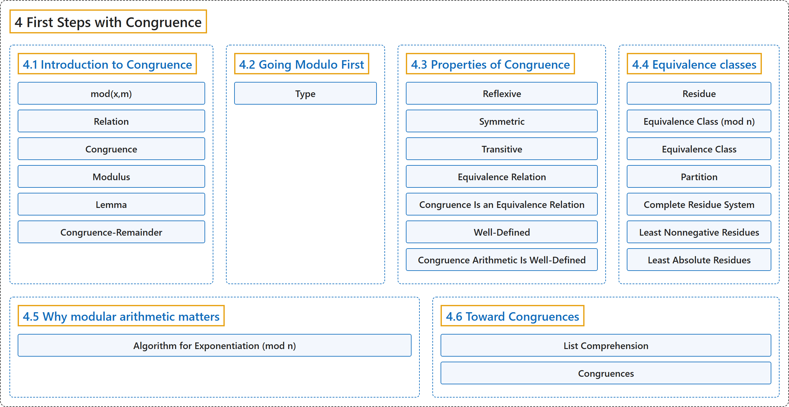

# 4 First Steps with Congruence

## Classification

## Glossary

| Term | Definition | 中文翻译 | Source |
|---|---|---|---|
| **4 First Steps with Congruence** 同余初步 | (No definition) | （无定义） | [Crisman, 2024, chapter 4](https://math.gordon.edu/ntic/ntic/chapter-intro-congruence.html) |
| **[4.1 Introduction to Congruence](4-1-introduction-to-congruence.md)** 同余简介 | (No definition) | （无定义） | [Crisman, 2024, section 4.1](https://math.gordon.edu/ntic/ntic/section-intro-congruence.html) |
| **[4.2 Going Modulo First](4-2-going-modulo-first.md)** 先取模 | (No definition) | （无定义） | [Crisman, 2024, section 4.2](https://math.gordon.edu/ntic/ntic/section-modulo-first.html) |
| **[4.3 Properties of Congruence](4-3-properties-of-congruence.md)** 同余的性质 | (No definition) | （无定义） | [Crisman, 2024, section 4.3](https://math.gordon.edu/ntic/ntic/section-cong-props.html) |
| **[4.4 Equivalence classes](4-4-equivalence-classes.md)** 等价类 | (No definition) | （无定义） | [Crisman, 2024, section 4.4](https://math.gordon.edu/ntic/ntic/section-equiv-classes.html) |
| **[4.5 Why modular arithmetic matters](4-5-why-modular-arithmetic-matters.md)** 模运算为何重要 | (No definition) | （无定义） | [Crisman, 2024, section 4.5](https://math.gordon.edu/ntic/ntic/section-why-mod-matters.html) |
| **[4.6 Toward Congruences](4-6-toward-congruences.md)** 走向同余方程 | (No definition) | （无定义） | [Crisman, 2024, section 4.6](https://math.gordon.edu/ntic/ntic/section-define-congruences.html) |

## References

Crisman, K.-D. (2024). *Number theory: In context and interactive* (June 26, 2024 edition). Gordon College. Retrieved October 29, 2026, from <https://math.gordon.edu/ntic/ntic/>
