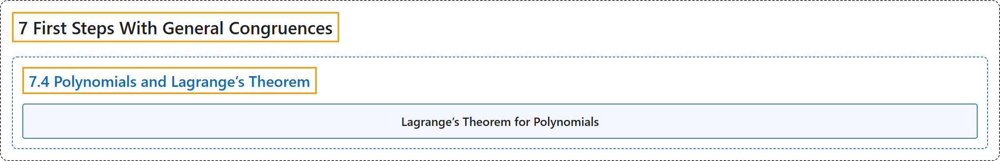

# 7.4 Polynomials and Lagrange’s Theorem

## Classification

## Glossary

| Term | Definition | 中文翻译 | Source |
|---|---|---|---|
| **7.4 Polynomials and Lagrange’s Theorem** 多项式与拉格朗日定理 | (No definition) | （无定义） | [Crisman, 2024, section 7.4](https://math.gordon.edu/ntic/ntic/section-lagrange-polys.html) |
| **Lagrange’s Theorem for Polynomials** 多项式的拉格朗日定理 | "If $p$ is prime and $f(x)$ is a degree $d$, integer coefficient, non-trivial polynomial (i.e. $f$ not identically zero or with all coefficients divisible by $p$), then **there are at most $d$ congruence classes of solutions of $f(x)\equiv 0$ modulo $p$**." | 若 $p$ 为素数，$f(x)$ 是 $d$ 次、整系数、非平凡的多项式（即 $f$ 不恒为零，也不是所有系数都能被 $p$ 整除），则 **$f(x)\equiv 0$ 模 $p$ 的解至多有 $d$ 个同余类**。 | [Crisman, 2024, Theorem 7.4.1](https://math.gordon.edu/ntic/ntic/section-lagrange-polys.html#theorem-lagrange-polynomial) |

## References

Crisman, K.-D. (2024). *Number theory: In context and interactive* (June 26, 2024 edition). Gordon College. Retrieved October 29, 2026, from <https://math.gordon.edu/ntic/ntic/>
