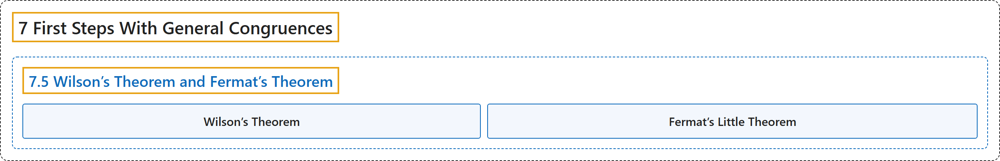

# 7.5 Wilson’s Theorem and Fermat’s Theorem

## Classification

## Glossary

| Term | Definition | 中文翻译 | Source |
|---|---|---|---|
| **7.5 Wilson’s Theorem and Fermat’s Theorem** 威尔逊定理与费马定理 | (No definition) | （无定义） | [Crisman, 2024, section 7.5](https://math.gordon.edu/ntic/ntic/section-wilson-flt.html) |
| **Wilson’s Theorem** 威尔逊定理 | "If $p$ is a prime, then **$(p-1)!\equiv -1\text{ (mod }p)$**, where the exclamation point here indicates the factorial." | 若 $p$ 是素数，则 **$(p-1)!\equiv -1\text{ (mod }p)$**，这里的感叹号表示阶乘。 | [Crisman, 2024, Theorem 7.5.1](https://math.gordon.edu/ntic/ntic/section-wilson-flt.html#theorem-wilsons-theorem) |
| **Fermat’s Little Theorem** 费马小定理 | "If $\gcd(a,p)=1$ for $p$ a prime, then **$a^{p-1}\equiv 1\text{ (mod }p)$**." | 若 $p$ 是素数且 $\gcd(a,p)=1$，则 **$a^{p-1}\equiv 1\text{ (mod }p)$**。 | [Crisman, 2024, Theorem 7.5.3](https://math.gordon.edu/ntic/ntic/section-wilson-flt.html#theorem-flt) |

## References

Crisman, K.-D. (2024). *Number theory: In context and interactive* (June 26, 2024 edition). Gordon College. Retrieved October 29, 2026, from <https://math.gordon.edu/ntic/ntic/>
