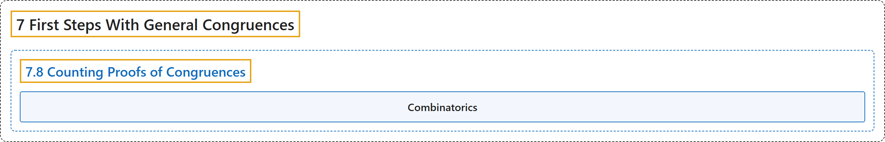

# 7.8 Counting Proofs of Congruences

## Classification

## Glossary

| Term | Definition | 中文翻译 | Source |
|---|---|---|---|
| **7.8 Counting Proofs of Congruences** 同余式的计数证明 | (No definition) | （无定义） | [Crisman, 2024, section 7.8](https://math.gordon.edu/ntic/ntic/section-congruence-counting-proofs.html) |
| **Combinatorics** 组合学 | "Some number theoretic results require essentially no number theory for their proof, but may be tackled using basic ideas from **combinatorics**, **the discipline of counting well**." | 有些数论结果的证明基本上不需要数论，而可以用**组合学**的基本思想来处理；组合学是**善于计数的学科**。 | [Crisman, 2024, section 7.8](https://math.gordon.edu/ntic/ntic/section-congruence-counting-proofs.html#section-congruence-counting-proofs-2-1) |

## References

Crisman, K.-D. (2024). *Number theory: In context and interactive* (June 26, 2024 edition). Gordon College. Retrieved October 29, 2026, from <https://math.gordon.edu/ntic/ntic/>
