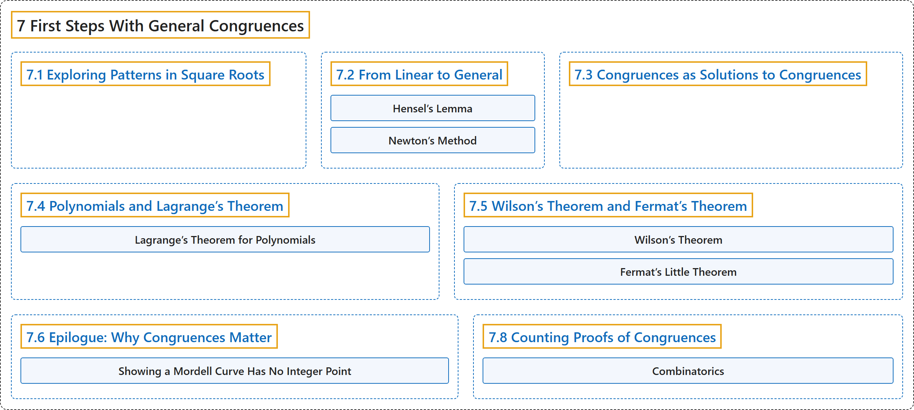

# 7 First Steps With General Congruences

## Classification

## Glossary

| Term | Definition | 中文翻译 | Source |
|---|---|---|---|
| **7 First Steps With General Congruences** 一般同余方程初步 | (No definition) | （无定义） | [Crisman, 2024, chapter 7](https://math.gordon.edu/ntic/ntic/chapter-general-congruences.html) |
| **[7.1 Exploring Patterns in Square Roots](7-1-exploring-patterns-in-square-roots.md)** 探索平方根中的规律 | (No definition) | （无定义） | [Crisman, 2024, section 7.1](https://math.gordon.edu/ntic/ntic/section-intro-gen-congruence.html) |
| **[7.2 From Linear to General](7-2-from-linear-to-general.md)** 从线性到一般 | (No definition) | （无定义） | [Crisman, 2024, section 7.2](https://math.gordon.edu/ntic/ntic/section-linear-to-gen.html) |
| **[7.3 Congruences as Solutions to Congruences](7-3-congruences-as-solutions-to-congruences.md)** 作为同余方程之解的同余式 | (No definition) | （无定义） | [Crisman, 2024, section 7.3](https://math.gordon.edu/ntic/ntic/section-congruences-sol-congruences.html) |
| **[7.4 Polynomials and Lagrange’s Theorem](7-4-polynomials-and-lagranges-theorem.md)** 多项式与拉格朗日定理 | (No definition) | （无定义） | [Crisman, 2024, section 7.4](https://math.gordon.edu/ntic/ntic/section-lagrange-polys.html) |
| **[7.5 Wilson’s Theorem and Fermat’s Theorem](7-5-wilsons-theorem-and-fermats-theorem.md)** 威尔逊定理与费马定理 | (No definition) | （无定义） | [Crisman, 2024, section 7.5](https://math.gordon.edu/ntic/ntic/section-wilson-flt.html) |
| **[7.6 Epilogue: Why Congruences Matter](7-6-epilogue-why-congruences-matter.md)** 尾声：同余为何重要 | (No definition) | （无定义） | [Crisman, 2024, section 7.6](https://math.gordon.edu/ntic/ntic/section-why-congruences.html) |
| **[7.8 Counting Proofs of Congruences](7-8-counting-proofs-of-congruences.md)** 同余式的计数证明 | (No definition) | （无定义） | [Crisman, 2024, section 7.8](https://math.gordon.edu/ntic/ntic/section-congruence-counting-proofs.html) |

## References

Crisman, K.-D. (2024). *Number theory: In context and interactive* (June 26, 2024 edition). Gordon College. Retrieved October 29, 2026, from <https://math.gordon.edu/ntic/ntic/>
