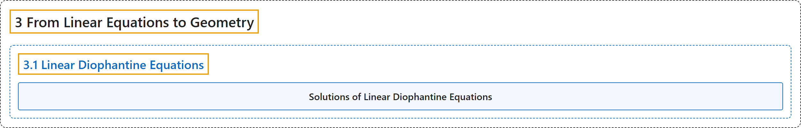

# 3.1 Linear Diophantine Equations

## Classification

## Glossary

| Term | Definition | 中文翻译 | Source |
|---|---|---|---|
| **3.1 Linear Diophantine Equations** 线性丢番图方程 | "The first goal for this chapter is to completely solve all **linear Diophantine equations** (of two variables). This is the question of **finding solutions $x,y\in\mathbb{Z}$ of equations of the generic form** $ax+by=c\text{ for given }a,b,c\in\mathbb{Z}$." | 本章的第一个目标是彻底求解所有（二元）**线性丢番图方程**。这个问题就是**求一般形式为** $ax+by=c$（$a,b,c\in\mathbb{Z}$ 给定）**的方程的解 $x,y\in\mathbb{Z}$**。 | [Crisman, 2024, section 3.1](https://math.gordon.edu/ntic/ntic/section-lin-dioph.html#section-lin-dioph-4-1) |
| **Solutions of Linear Diophantine Equations** 线性丢番图方程的解 | "Given integers $a,b,c$, we wish to find all integer solutions $x,y$ to $ax+by=c$. Let $d=\gcd(a,b)$, unless $a=b=0$ in which case let $d=0$. We will consider cases by ease of generating solutions. When $c$ is not a multiple of $d$ (including if $c\neq d=0$), **there is no solution**. When $a$ or $b$ is zero (but not both) and the nonzero one divides $c$, **there are infinitely many solutions that require little work to obtain**. When $a,b\neq 0$ and $c=d$, **there are infinitely many solutions, but you will need to first obtain *one* solution in order to generate the others**. When $a,b\neq 0$ and $c$ is a nontrivial multiple of $d$, **there are infinitely many solutions that are easiest to generate by means of a solution to $ax+by=d$**." | 给定整数 $a,b,c$，我们要求 $ax+by=c$ 的全部整数解 $x,y$。令 $d=\gcd(a,b)$；若 $a=b=0$，则令 $d=0$。我们按产生解的难易分情况讨论。当 $c$ 不是 $d$ 的倍数时（包括 $c\neq d=0$ 的情形），**无解**。当 $a$ 或 $b$ 为零（但不全为零）且非零的那个整除 $c$ 时，**有无穷多解，几乎不费力就能得到**。当 $a,b\neq 0$ 且 $c=d$ 时，**有无穷多解，但需要先求出*一个*解，才能生成其余的解**。当 $a,b\neq 0$ 且 $c$ 是 $d$ 的非平凡倍数时，**有无穷多解，最容易借助 $ax+by=d$ 的一个解来生成**。 | [Crisman, 2024, Theorem 3.1.2](https://math.gordon.edu/ntic/ntic/section-lin-dioph.html#theorem-LDE) |

## References

Crisman, K.-D. (2024). *Number theory: In context and interactive* (June 26, 2024 edition). Gordon College. Retrieved October 29, 2026, from <https://math.gordon.edu/ntic/ntic/>
