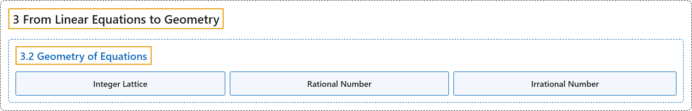

# 3.2 Geometry of Equations

## Classification

## Glossary

| Term | Definition | 中文翻译 | Source |
|---|---|---|---|
| **3.2 Geometry of Equations** 方程的几何 | (No definition) | （无定义） | [Crisman, 2024, section 3.2](https://math.gordon.edu/ntic/ntic/section-lin-geom.html) |
| **Integer Lattice** 整数格 | "The **integer lattice** is **the set of points $(m,n)$ for $m,n\in\mathbb{Z}$**." | **整数格**是**点 $(m,n)$（$m,n\in\mathbb{Z}$）组成的集合**。 | [Crisman, 2024, Definition 3.2.2](https://math.gordon.edu/ntic/ntic/section-lin-geom.html#definition-integer-lattice) |
| **Rational Number** 有理数 | "We consider **any ratio of integers $\frac{p}{q}$ with $q\neq 0$** to be a **rational number**, with equivalent ratios such as $\frac{1}{2}=\frac{3}{6}$ identified as in school mathematics. The set of all rationals is denoted $\mathbb{Q}$." | 我们把**任何分母 $q\neq 0$ 的整数之比 $\frac{p}{q}$** 视为一个**有理数**，像 $\frac{1}{2}=\frac{3}{6}$ 这样相等的比按中小学数学的做法视为同一个。全体有理数的集合记作 $\mathbb{Q}$。 | [Crisman, 2024, Definition 3.2.3](https://math.gordon.edu/ntic/ntic/section-lin-geom.html#definition-rational-irrational) |
| **Irrational Number** 无理数 | "We consider any ratio of integers $\frac{p}{q}$ with $q\neq 0$ to be a rational number, with equivalent ratios such as $\frac{1}{2}=\frac{3}{6}$ identified as in school mathematics. The set of all rationals is denoted $\mathbb{Q}$. If **a (real, $\mathbb{R}$) number is not writeable in these terms**, it is called an **irrational number**." | 我们把任何分母 $q\neq 0$ 的整数之比 $\frac{p}{q}$ 视为一个有理数，像 $\frac{1}{2}=\frac{3}{6}$ 这样相等的比按中小学数学的做法视为同一个。全体有理数的集合记作 $\mathbb{Q}$。若**一个（实，$\mathbb{R}$）数不能写成这种形式**，就称它为**无理数**。 | [Crisman, 2024, Definition 3.2.3](https://math.gordon.edu/ntic/ntic/section-lin-geom.html#definition-rational-irrational) |

## References

Crisman, K.-D. (2024). *Number theory: In context and interactive* (June 26, 2024 edition). Gordon College. Retrieved October 29, 2026, from <https://math.gordon.edu/ntic/ntic/>
