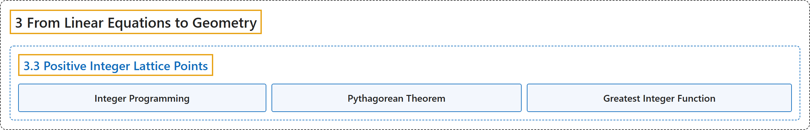

# 3.3 Positive Integer Lattice Points

## Classification

## Glossary

| Term | Definition | 中文翻译 | Source |
|---|---|---|---|
| **3.3 Positive Integer Lattice Points** 正整数格点 | "Assume there exists a solution (hence infinitely many) to $ax+by=c$. How many such **solution pairs $(x,y)$ have $x$ and $y$ both positive**?" | 假设 $ax+by=c$ 有解（从而有无穷多解）。这样的**解对 $(x,y)$ 中有多少个满足 $x$ 与 $y$ 都为正**？ | [Crisman, 2024, Question 3.3.1](https://math.gordon.edu/ntic/ntic/section-positive-lattice.html#question-positive-lattice) |
| **Integer Programming** 整数规划 | "This is similar to the conductor question. It is closely related to ***integer programming***, something with industrial applications." | 这与导子问题类似。它与***整数规划***密切相关，后者有工业上的应用。 | [Crisman, 2024, section 3.3](https://math.gordon.edu/ntic/ntic/section-positive-lattice.html#section-positive-lattice-4-3) |
| **Pythagorean Theorem** 勾股定理 | "Then, using our technique from last time, from the solution $(x_0,y_0)$ we get a new solution $(x_0+b,y_0-a)$, so the distance between any two solutions is, by the **Pythagorean Theorem**, $\sqrt{[(x_0+b)-x_0]^2+[(y_0-a)+y_0]^2}=\sqrt{a^2+b^2}$." | 然后，用上次的技巧，由解 $(x_0,y_0)$ 得到新解 $(x_0+b,y_0-a)$，所以由**勾股定理**，任意两个解之间的距离是 $\sqrt{[(x_0+b)-x_0]^2+[(y_0-a)+y_0]^2}=\sqrt{a^2+b^2}$。 | [Crisman, 2024, subsection 3.3.1](https://math.gordon.edu/ntic/ntic/section-positive-lattice.html#subsection-pos-lattice-ideas-3) |
| **Greatest Integer Function** 最大整数函数 | "The ***greatest integer function*** (also called the ***floor*** function) is **the function which takes a real number $x$ and returns the largest integer below it (or equal to it)**. We notate it $\lfloor x\rfloor$." | ***最大整数函数***（也称***下取整***函数）是**把实数 $x$ 映到不超过它的最大整数的函数**。记作 $\lfloor x\rfloor$。 | [Crisman, 2024, Definition 3.3.3](https://math.gordon.edu/ntic/ntic/section-positive-lattice.html#definition-greatest-integer) |

## References

Crisman, K.-D. (2024). *Number theory: In context and interactive* (June 26, 2024 edition). Gordon College. Retrieved October 29, 2026, from <https://math.gordon.edu/ntic/ntic/>
