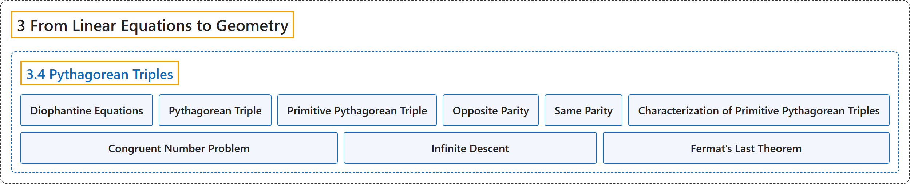

# 3.4 Pythagorean Triples

## Classification

## Glossary

| Term | Definition | 中文翻译 | Source |
|---|---|---|---|
| **3.4 Pythagorean Triples** 毕达哥拉斯三元组 | (No definition) | （无定义） | [Crisman, 2024, section 3.4](https://math.gordon.edu/ntic/ntic/section-pyth-triples.html) |
| **Diophantine Equations** 丢番图方程 | "There are a lot of other interesting questions that one can ask about pure integers, and **polynomial equations they might satisfy** (so-called **Diophantine equations**)." | 关于纯整数，以及**它们可能满足的多项式方程**（即所谓的**丢番图方程**），还可以问许多别的有趣问题。 | [Crisman, 2024, subsection 3.4.1](https://math.gordon.edu/ntic/ntic/section-pyth-triples.html#subsection-pyth-triples-defn-2) |
| **Pythagorean Triple** 毕达哥拉斯三元组 | "We call **a triple of integers $x,y,z$ such that $x^2+y^2=z^2$** a **Pythagorean triple**." | 我们把**满足 $x^2+y^2=z^2$ 的整数三元组 $x,y,z$** 称为**毕达哥拉斯三元组**（勾股数）。 | [Crisman, 2024, Definition 3.4.2](https://math.gordon.edu/ntic/ntic/section-pyth-triples.html#definition-pyth-triple) |
| **Primitive Pythagorean Triple** 本原毕达哥拉斯三元组 | "A Pythagorean triple with **$x,y,z$ mutually relatively prime** is called a **primitive Pythagorean triple**." | **$x,y,z$ 两两互素**的毕达哥拉斯三元组称为**本原毕达哥拉斯三元组**。 | [Crisman, 2024, Definition 3.4.3](https://math.gordon.edu/ntic/ntic/section-pyth-triples.html#definition-prim-pyth-triple) |
| **Opposite Parity** 奇偶性相反 | "We say two integers $p,q$ have **opposite parity** if **one is even and the other is odd**, and we say they have the same parity otherwise." | 若两个整数 $p,q$ 中**一个是偶数、另一个是奇数**，就说它们**奇偶性相反**；否则说它们奇偶性相同。 | [Crisman, 2024, Definition 3.4.5](https://math.gordon.edu/ntic/ntic/section-pyth-triples.html#definition-opposite-parity) |
| **Same Parity** 奇偶性相同 | "We say two integers $p,q$ have opposite parity if one is even and the other is odd, and we say they have the **same parity** **otherwise**." | 若两个整数 $p,q$ 中一个是偶数、另一个是奇数，就说它们奇偶性相反；**否则**说它们**奇偶性相同**。 | [Crisman, 2024, Definition 3.4.5](https://math.gordon.edu/ntic/ntic/section-pyth-triples.html#definition-opposite-parity) |
| **Characterization of Primitive Pythagorean Triples** 本原毕达哥拉斯三元组的刻画 | "For a primitive triple $x,y,z$, where $x$ is odd, **there exist integers $p,q$ such that** $z=p^2+q^2,\; x=q^2-p^2,\; \text{ and }y=2pq$. Further, **$p$ and $q$ must have opposite parity as well as be coprime**." | 对 $x$ 为奇数的本原三元组 $x,y,z$，**存在整数 $p,q$ 使得** $z=p^2+q^2,\; x=q^2-p^2,\; \text{ and }y=2pq$。此外，**$p$ 与 $q$ 必须奇偶性相反且互素**。 | [Crisman, 2024, Theorem 3.4.6](https://math.gordon.edu/ntic/ntic/section-pyth-triples.html#theorem-charact-prim-pyth) |
| **Congruent Number Problem** 同余数问题 | "This linked news update from the American Institute of Mathematics gives some background on the **congruent number problem**, which asks **the related question of which Pythagorean triangles with *rational* side lengths give integer areas**." | 这篇来自美国数学研究所的新闻介绍了**同余数问题**的一些背景，它问的是**一个相关的问题：哪些边长为*有理数*的直角三角形面积是整数**。 | [Crisman, 2024, subsection 3.4.3](https://math.gordon.edu/ntic/ntic/section-pyth-triples.html#subsubsection-pyth-tri-areas-poss-9) |
| **Infinite Descent** 无穷递降法 | "Now we will do something very clever. It is **a proof strategy**, similar to something the Greeks used occasionally, which Fermat used for many of his proofs, called **infinite descent**. We are going to **take that (hypothetical) triangle, and produce a triangle with strictly smaller sides but otherwise with the same properties** – including integer sides and square area!" | 现在我们来做一件非常巧妙的事。这是一种**证明策略**，与希腊人偶尔用过的方法类似，费马在他的许多证明中都用过，称为**无穷递降法**。我们要**取那个（假设存在的）三角形，造出一个边严格更小、其他性质都相同的三角形**，包括边为整数、面积为平方数！ | [Crisman, 2024, subsection 3.4.3](https://math.gordon.edu/ntic/ntic/section-pyth-triples.html#subsubsection-pyth-tri-areas-sq-7) |
| **Fermat’s Last Theorem** 费马大定理 | "In Exercise 3.6.17 you will use this to prove the famous first case of **Fermat’s Last Theorem**: **There are no three positive integers $x,y,z$ such that** $x^4+y^4=z^4$." | 在习题 3.6.17 中，你将用它来证明**费马大定理**著名的第一个情形：**不存在三个正整数 $x,y,z$ 使得** $x^4+y^4=z^4$。 | [Crisman, 2024, subsection 3.4.3](https://math.gordon.edu/ntic/ntic/section-pyth-triples.html#subsubsection-pyth-tri-areas-sq-12) |

## References

Crisman, K.-D. (2024). *Number theory: In context and interactive* (June 26, 2024 edition). Gordon College. Retrieved October 29, 2026, from <https://math.gordon.edu/ntic/ntic/>
