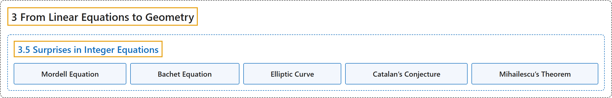

# 3.5 Surprises in Integer Equations

## Classification

## Glossary

| Term | Definition | 中文翻译 | Source |
|---|---|---|---|
| **3.5 Surprises in Integer Equations** 整数方程中的意外 | (No definition) | （无定义） | [Crisman, 2024, section 3.5](https://math.gordon.edu/ntic/ntic/section-integer-equations.html) |
| **Mordell Equation** 莫德尔方程 | "The **general form $x^3=y^2+k$** in the preceding interact can be known both as as a Bachet equation or **Mordell equation**. We will use the latter **for the general form** and reserve the former only for the special case $k=2$, where a cube and square are two apart." | 上面交互图中的**一般形式 $x^3=y^2+k$** 既可以叫巴歇方程，也可以叫**莫德尔方程**。我们用后者**指一般形式**，前者只留给 $k=2$ 这个特殊情形，即立方数与平方数相差二。 | [Crisman, 2024, section 3.5](https://math.gordon.edu/ntic/ntic/section-integer-equations.html#section-integer-equations-7) |
| **Bachet Equation** 巴歇方程 | "The general form $x^3=y^2+k$ in the preceding interact can be known both as as a **Bachet equation** or Mordell equation. We will use the latter for the general form and reserve the former only for **the special case $k=2$, where a cube and square are two apart**." | 上面交互图中的一般形式 $x^3=y^2+k$ 既可以叫**巴歇方程**，也可以叫莫德尔方程。我们用后者指一般形式，前者只留给 **$k=2$ 这个特殊情形，即立方数与平方数相差二**。 | [Crisman, 2024, section 3.5](https://math.gordon.edu/ntic/ntic/section-integer-equations.html#section-integer-equations-7) |
| **Elliptic Curve** 椭圆曲线 | "The Bachet/Mordell equation **connects directly to** objects called **elliptic curves**." | 巴歇/莫德尔方程**直接联系到**称为**椭圆曲线**的对象。 | [Crisman, 2024, section 3.5](https://math.gordon.edu/ntic/ntic/section-integer-equations.html#section-integer-equations-9) |
| **Catalan’s Conjecture** 卡塔兰猜想 | "**Eight and nine are consecutive perfect (nontrivial) powers. Are there any others?**" | **八和九是相邻的（非平凡）完全幂。还有别的吗？** | [Crisman, 2024, Question 3.5.5](https://math.gordon.edu/ntic/ntic/section-integer-equations.html#question-catalan) |
| **Mihailescu’s Theorem** 米哈伊列斯库定理 | "This *was* called Catalan’s conjecture because, as of 2002, **the fact that there are no other such powers** is **Mihailescu’s Theorem**!" | 它*曾*被称为卡塔兰猜想，因为自 2002 年起，**不存在其他这样的幂这一事实**就是**米哈伊列斯库定理**了！ | [Crisman, 2024, Historical remark 3.5.6](https://math.gordon.edu/ntic/ntic/section-integer-equations.html#remark-catalan-mihailescu) |

## References

Crisman, K.-D. (2024). *Number theory: In context and interactive* (June 26, 2024 edition). Gordon College. Retrieved October 29, 2026, from <https://math.gordon.edu/ntic/ntic/>
