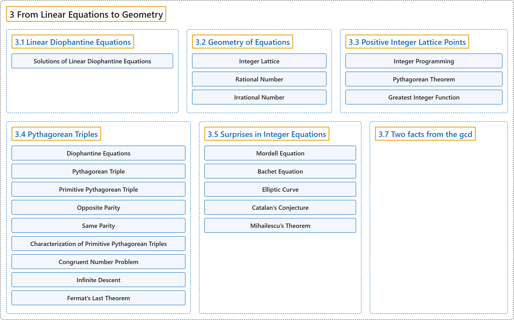

# 3 From Linear Equations to Geometry

## Classification

## Glossary

| Term | Definition | 中文翻译 | Source |
|---|---|---|---|
| **3 From Linear Equations to Geometry** 从线性方程到几何 | (No definition) | （无定义） | [Crisman, 2024, chapter 3](https://math.gordon.edu/ntic/ntic/chapter-lin-dioph-geom.html) |
| **[3.1 Linear Diophantine Equations](3-1-linear-diophantine-equations.md)** 线性丢番图方程 | (No definition) | （无定义） | [Crisman, 2024, section 3.1](https://math.gordon.edu/ntic/ntic/section-lin-dioph.html) |
| **[3.2 Geometry of Equations](3-2-geometry-of-equations.md)** 方程的几何 | (No definition) | （无定义） | [Crisman, 2024, section 3.2](https://math.gordon.edu/ntic/ntic/section-lin-geom.html) |
| **[3.3 Positive Integer Lattice Points](3-3-positive-integer-lattice-points.md)** 正整数格点 | (No definition) | （无定义） | [Crisman, 2024, section 3.3](https://math.gordon.edu/ntic/ntic/section-positive-lattice.html) |
| **[3.4 Pythagorean Triples](3-4-pythagorean-triples.md)** 毕达哥拉斯三元组 | (No definition) | （无定义） | [Crisman, 2024, section 3.4](https://math.gordon.edu/ntic/ntic/section-pyth-triples.html) |
| **[3.5 Surprises in Integer Equations](3-5-surprises-in-integer-equations.md)** 整数方程中的意外 | (No definition) | （无定义） | [Crisman, 2024, section 3.5](https://math.gordon.edu/ntic/ntic/section-integer-equations.html) |
| **[3.7 Two facts from the gcd](3-7-two-facts-from-the-gcd.md)** 关于最大公约数的两个事实 | (No definition) | （无定义） | [Crisman, 2024, section 3.7](https://math.gordon.edu/ntic/ntic/section-two-gcd-facts.html) |

## References

Crisman, K.-D. (2024). *Number theory: In context and interactive* (June 26, 2024 edition). Gordon College. Retrieved October 29, 2026, from <https://math.gordon.edu/ntic/ntic/>
