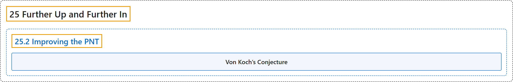

# 25.2 Improving the PNT

## Classification

## Glossary

| Term | Definition | 中文翻译 | Source |
|---|---|---|---|
| **25.2 Improving the PNT** 改进素数定理 | (No definition) | （无定义） | [Crisman, 2024, section 25.2](https://math.gordon.edu/ntic/ntic/section-improve-pnt.html) |
| **Von Koch’s Conjecture** 冯科赫猜想 | "The (absolute value of the) error in the PNT is less than **$\frac{1}{8\pi}\sqrt{x}\log(x)$**." | 素数定理误差的（绝对值）小于 **$\frac{1}{8\pi}\sqrt{x}\log(x)$**。 | [Crisman, 2024, Conjecture 25.2.2](https://math.gordon.edu/ntic/ntic/section-improve-pnt.html#conjecture-koch-rh) |

## References

Crisman, K.-D. (2024). *Number theory: In context and interactive* (June 26, 2024 edition). Gordon College. Retrieved October 29, 2026, from <https://math.gordon.edu/ntic/ntic/>
