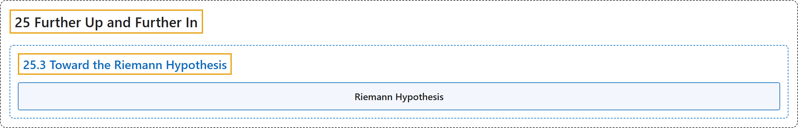

# 25.3 Toward the Riemann Hypothesis

## Classification

## Glossary

| Term | Definition | 中文翻译 | Source |
|---|---|---|---|
| **25.3 Toward the Riemann Hypothesis** 走向黎曼猜想 | (No definition) | （无定义） | [Crisman, 2024, section 25.3](https://math.gordon.edu/ntic/ntic/section-toward-riemann.html) |
| **Riemann Hypothesis** 黎曼猜想 | "**All the zeros of $\zeta(s)=\zeta(\sigma+it)$ where $t\neq 0$ are on $\sigma=1/2$.**" | **$\zeta(s)=\zeta(\sigma+it)$ 满足 $t\neq 0$ 的所有零点都在 $\sigma=1/2$ 上**。 | [Crisman, 2024, Conjecture 25.3.7](https://math.gordon.edu/ntic/ntic/section-toward-riemann.html#conjecture-riemann-hypothesis) |

## References

Crisman, K.-D. (2024). *Number theory: In context and interactive* (June 26, 2024 edition). Gordon College. Retrieved October 29, 2026, from <https://math.gordon.edu/ntic/ntic/>
