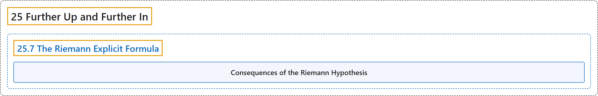

# 25.7 The Riemann Explicit Formula

## Classification

## Glossary

| Term | Definition | 中文翻译 | Source |
|---|---|---|---|
| **25.7 The Riemann Explicit Formula** 黎曼显式公式 | "**$\pi(x)=\sum_{n=1}^\infty \frac{\mu(n)}{n}\left[ Li(x^{1/n})-\sum_{\rho}\left(Li(x^{\rho/n})+Li(x^{\bar{\rho}/n})\right)+\int_{x^{1/n}}^\infty\frac{dt}{t(t^2-1)\log(t)}\right]$**" | **$\pi(x)=\sum_{n=1}^\infty \frac{\mu(n)}{n}\left[ Li(x^{1/n})-\sum_{\rho}\left(Li(x^{\rho/n})+Li(x^{\bar{\rho}/n})\right)+\int_{x^{1/n}}^\infty\frac{dt}{t(t^2-1)\log(t)}\right]$** | [Crisman, 2024, Fact 25.7.1](https://math.gordon.edu/ntic/ntic/section-riemann-formula.html#fact-riemann-formula) |
| **Consequences of the Riemann Hypothesis** 黎曼猜想的推论 | "The following follow from **the Riemann Hypothesis or a generalization** for things like general Dirichlet series." | 下面这些由**黎曼猜想或其推广**（用于一般的狄利克雷级数等）推出。 | [Crisman, 2024, Fact 25.7.3](https://math.gordon.edu/ntic/ntic/section-riemann-formula.html#fact-grh) |

## References

Crisman, K.-D. (2024). *Number theory: In context and interactive* (June 26, 2024 edition). Gordon College. Retrieved October 29, 2026, from <https://math.gordon.edu/ntic/ntic/>
